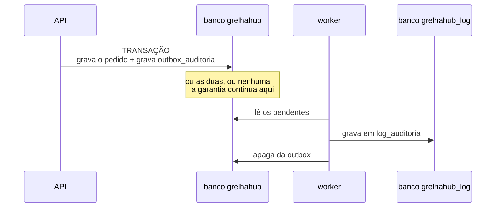

# ADR-0017 — Três bancos: aplicação, arquivo e log

| Campo | Valor |
|-------|-------|
| Situação | **Aceita** |
| Data | 18/08/2026 |
| Decide sobre | Observabilidade, retenção e crescimento do dado |
| Relacionada | [ADR-0004](0004-postgresql-como-sgbd.md), [ADR-0006](0006-deploy-em-vps-unica-com-docker.md), [ADR-0009](0009-onde-as-regras-de-negocio-vivem.md), [ADR-0018](0018-imagem-como-binario-no-banco.md) |
| Substitui parcialmente | [ADR-0015](0015-armazenamento-de-imagem.md) |

---

## Contexto

Até aqui o sistema tinha **um banco só**, e três coisas muito diferentes moravam nele:

1. O **dado operacional** — pedido, produto, usuário. Pequeno, quente, consultado o tempo todo.
2. A **trilha de auditoria** — cresce a cada gravação, nunca é apagada (`RN-GER-002`), e é lida
   raramente. Já era a tabela que mais crescia.
3. E, fora do banco, os **arquivos de imagem**, num volume de disco (ADR-0015).

Três problemas concretos disso:

- **Backup e retenção iguais para coisas desiguais.** O dado operacional precisa de restauração
  rápida; a trilha de três anos atrás, não. Com tudo junto, o `dump` do banco carrega a trilha
  inteira toda vez.
- **Não havia registro de exceção.** Quando algo quebrava em produção, o vestígio era a saída de
  log do contêiner — que o `docker compose logs` trunca e o reinício apaga. Não dava para responder
  "quantas vezes isso aconteceu esta semana".
- **Arquivo fora do banco não tem transação.** Detalhado no [ADR-0018](0018-imagem-como-binario-no-banco.md).

## Decisão

> **Três bancos no mesmo PostgreSQL: `grelhahub` (aplicação), `grelhahub_arquivo` (binários) e
> `grelhahub_log` (auditoria e exceções).**

Mesma instância, e isso é deliberado: a VPS é única (ADR-0006), e três contêineres de banco
triplicariam memória e conexões para isolar uma falha que, numa máquina só, derruba os três de
qualquer jeito. O que ganhamos é o que realmente doía: **migrations, backup, retenção e
crescimento separados**.

| Banco | Tabelas | Cresce com | Retenção |
|-------|---------|-----------|----------|
| `grelhahub` | as 19 do modelo, mais `arquivo` (metadado) e `outbox_auditoria` | o negócio | permanente |
| `grelhahub_arquivo` | `arquivo_binario` | fotos de produto e logos | segue o metadado |
| `grelhahub_log` | `log_auditoria`, `log_excecao` | cada gravação e cada falha | política própria |

## A trilha atravessa dois bancos — e a garantia é mantida por *outbox*

⚠⚠ **Este é o ponto que exigiu decisão, e não podia ser resolvido por preferência.**

Hoje o interceptador de auditoria adiciona a linha da trilha ao **mesmo `ChangeTracker`** da
operação: ou as duas gravam, ou nenhuma grava. É essa propriedade que torna a trilha confiável —
não existe operação sem registro.

Bancos diferentes **não têm transação em comum**. Escrever direto no banco de log, fora da
transação, significaria: a operação grava, a escrita da trilha falha, e **ninguém fica sabendo**.
Numa trilha de auditoria isso não é uma degradação aceitável — é a destruição da propriedade que
a faz existir.

A saída é o padrão **outbox**:

**O que se ganha:** nada se perde. Se a API cair entre a transação e a cópia, o registro continua
na outbox e o worker o encontra na próxima volta.

**O que se paga, declarado:**

- A trilha chega ao banco de log com **segundos de atraso**. Quem consultar a trilha de uma
  operação que acabou de acontecer pode não a ver ainda.
- Uma tabela a mais e um serviço em segundo plano.
- A cópia precisa ser **idempotente**: o worker pode gravar e cair antes de apagar da outbox, e a
  segunda tentativa não pode duplicar a linha. O `id` do registro é o mesmo nos dois lados, e é ele
  que garante isso.

## Consequências

### Positivas

- **Retenção separada.** Apagar trilha de cinco anos não toca no banco operacional.
- **Backup proporcional.** O `dump` do banco de negócio volta a ser pequeno.
- **Exceção vira dado.** Dá para perguntar "o que mais quebrou esta semana" com `SELECT`.
- **A imutabilidade da trilha continua imposta pelo banco** — o gatilho vai junto para o banco de
  log.

### Negativas, e são reais

- **Três `DbContext`, três conjuntos de migrations, três connection strings.** Toda mudança de
  esquema precisa saber a qual banco pertence.
- **Não há mais `JOIN` entre trilha e dado operacional.** Ver "quem alterou este pedido" passa a
  ser duas consultas. Aceitável: a trilha já guarda `unidade_id`, `entidade` e `registro_id`.
- **A trilha tem atraso.** Declarado acima.
- **O ambiente de desenvolvimento e o de teste sobem três bancos.** No teste de integração é o
  mesmo contêiner com três bancos criados na partida.

## Alternativas descartadas

| Alternativa | Por que não |
|-------------|-------------|
| **Schemas separados no mesmo banco** | Separa o nome e não separa o que doía: o `dump` continua único, e a retenção continua acoplada |
| **Contêineres PostgreSQL separados** | Triplica memória e conexões numa VPS única, para isolar falha que a máquina não isola |
| **Escrever a trilha direto no banco de log** | Perde a garantia de "não existe operação sem registro". Ver acima |
| **Ferramenta externa de observabilidade** | Custo e uma dependência a mais para um sistema que ainda não tem cliente em produção. A tabela responde as perguntas de hoje, e migrar depois é exportar |

## Quando reabrir

- Se o volume de trilha passar do que uma instância só aguenta — aí a conversa é **particionar por
  data operacional**, antes de separar instância.
- Se o atraso da outbox começar a atrapalhar alguém de verdade. Hoje ninguém consulta a trilha em
  tempo real.
