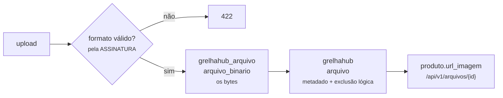

# ADR-0018 — Imagem como binário no banco, servida em base64

| Campo | Valor |
|-------|-------|
| Situação | **Aceita e implementada** |
| Data | 18/08/2026 |
| Decide sobre | `RN-VEN-042` (imagem do produto), `RN-GER-026` (logo da unidade) |
| Relacionada | [ADR-0017](0017-tres-bancos-aplicacao-arquivo-e-log.md) |
| **Substitui** | [ADR-0015](0015-armazenamento-de-imagem.md) — imagem em volume de disco |

---

## Contexto

O [ADR-0015](0015-armazenamento-de-imagem.md) colocou a imagem num **volume de disco** montado no
contêiner, servida pelo Nginx. A decisão estava certa para o que se sabia então, e três coisas
mudaram desde ela.

**1. Arquivo em disco não tem transação.** Gravar o arquivo e gravar a linha do produto são duas
operações sem nada em comum. As duas falhas possíveis são silenciosas:

- arquivo gravado, transação desfeita → **arquivo órfão**, ocupando disco para sempre, sem ninguém
  sabendo que existe;
- linha gravada apontando para um arquivo que não gravou → **imagem quebrada** no cardápio público.

**2. `RN-GER-002` diz que nada transacional é excluído fisicamente** — e o arquivo em disco não
sabe disso. Produto desativado deixava o arquivo lá; produto reativado dependia de o arquivo ainda
existir. A exclusão lógica parava na borda do sistema de arquivos.

**3. Backup em duas peças.** O `dump` do banco não leva as imagens. Restaurar o banco sem restaurar
o volume devolve um cardápio de molduras vazias — e ninguém percebe até um cliente abrir a vitrine.

## Decisão

> **O binário vai para o banco `grelhahub_arquivo`, o metadado vai para a tabela `arquivo` do banco
> da aplicação, e a imagem é entregue ao cliente em base64.**

⚠ **A coluna do produto continua sendo `url_imagem`, e não virou `arquivo_id`.** O rascunho desta
ADR previa a chave estrangeira; a implementação manteve o texto por um motivo prático que só
apareceu ao escrever a migration: as referências gravadas antes de 18/08/2026 apontam para
`/arquivos/...` (ADR-0015) e continuam válidas, servidas pelo Nginx. Uma coluna `uuid` obrigaria a
migrar todas elas **antes** de o código novo subir, num ambiente onde a migração ainda nem foi
decidida (ver *Migração do que já existe*). Guardando a **referência**, os dois formatos convivem e
a troca é incremental.

### Por que o metadado fica no banco da aplicação

É ele que participa das regras: pertence a uma unidade (`RN-GER-009`), tem exclusão lógica
(`RN-GER-002`), entra na trilha de auditoria. O binário não tem regra nenhuma — é um monte de
bytes com um identificador.

Isso também mantém o **`JOIN` que importa**: `produto → arquivo` é uma consulta só, no mesmo banco.
Só a busca dos bytes atravessa para o outro, e ela acontece uma vez por imagem, não por listagem.

### A ordem de gravação, e por que ela é essa

**Binário primeiro, metadado depois.** Invertida, uma falha deixaria metadado apontando para bytes
que não existem — imagem quebrada na vitrine, que é a falha visível. Nesta ordem, a falha possível
é um binário sem metadado: **invisível para o sistema e removível por varredura**, porque o banco
de arquivo sabe quais ids nenhum metadado referencia.

⚠ É a mesma escolha do ADR-0016 para e-mail: quando não há transação, **falhe do lado que não
mente para o usuário**.

## A entrega: duas representações, e qual vai em cada lugar

O binário está no banco. **Como ele chega ao navegador** é uma segunda decisão, e ela foi tomada na
implementação — a versão original desta ADR dizia "base64" e só depois listava, no parágrafo de
mitigação, exatamente o problema que base64 tem numa vitrine. Fazer as duas coisas custou vinte
linhas de controller, então as duas existem:

| Rota | O que devolve | Onde é usada |
|------|---------------|--------------|
| `GET /api/v1/arquivos/{id}` | **os bytes**, com `Content-Type` da assinatura | `` — cardápio público e cartaz |
| `GET /api/v1/arquivos/{id}/base64` | **data URI** (`data:image/png;base64,…`) | miniatura do painel, pré-visualização, exportação |

**Base64 cresce o conteúdo em ≈33% e não entra no cache de imagem do navegador.** Numa vitrine de
vinte produtos aberta no celular do cliente, isso são megabytes a mais antes do primeiro preço
aparecer na tela — e essa é a tela que decide se alguém pede.

Por isso a **rota padrão é a binária**, com `Cache-Control: public, max-age=604800, immutable`. O
cabeçalho é seguro porque a **identidade do arquivo é imutável**: trocar a imagem gera um id novo
(`RN-GER-002` — a anterior não é apagada), então o conteúdo de uma URL nunca muda. É a mitigação
que o rascunho previa, aplicada de saída em vez de guardada para quando doesse.

A base64 fica onde ela é a ferramenta certa: **poucas imagens, atrás de sessão, conteúdo embutido**
— a miniatura do painel de cardápio, que já vem junto com a resposta e não precisa de uma segunda
viagem. O frontend escolhe por `services/imagens.ts`, e a escolha está comentada lá.

⚠ **Nenhuma listagem carrega base64.** Nem o cardápio público, nem o interno: eles devolvem a
**referência**, e quem quiser os bytes os pede. Uma listagem que embutisse a imagem entregaria o
cardápio inteiro em cada requisição, e o custo cresceria com o catálogo do cliente.

## Consequências

### Positivas

- **Uma transação.** Ou o produto e a imagem existem, ou nenhum dos dois.
- **Exclusão lógica de verdade** — o metadado tem `dh_exclusao` como qualquer registro transacional.
- **Backup em uma peça.** Restaurou o banco, restaurou o cardápio.
- **Sem arquivo órfão invisível**: o que sobra é detectável por consulta.
- **Isolamento por unidade** vale para a imagem como vale para o resto.

### Negativas

- **O `dump` do banco de arquivo é grande.** É por isso que ele é um banco separado (ADR-0017).
- **O Nginx deixa de servir a imagem nova: ela passa pela API.** Uma requisição a mais no caminho,
  e um processo a mais para derrubar junto se a API cair. O cabeçalho `immutable` devolve a maior
  parte disso ao cache do navegador.
- **A rota do arquivo é anônima**, como o diretório que ela substitui. O id (UUID v7) é a
  capacidade; quem tem a referência lê a imagem. Não é regressão — no ADR-0015 o diretório era
  público por desenho —, mas agora está escrito em um lugar só, e a exclusão lógica é conferida
  antes dos bytes, coisa que o Nginx não fazia.
- **Base64 continua custando +33%** onde ela é usada. Contida ao painel, e declarada acima.

## O que **não** muda

- A validação continua **pela assinatura do arquivo, nunca pela extensão** (`RN-VEN-042`).
- O nome recebido do usuário **nunca** é usado — agora nem chega a existir nome no disco.
- Tamanho e formato continuam limitados pelas mesmas regras.

## Migração do que já existe

As imagens gravadas em disco pelo ADR-0015 **não são migradas automaticamente**, e **continuam
funcionando**: o `location /arquivos/` do Nginx segue no ar, somente leitura, e as referências
antigas apontam para lá. O volume está marcado como legado no `docker-compose.yml`, com a condição
de saída escrita nele — quando nenhuma linha do banco apontar mais para `/arquivos/...`, o volume e
o `location` saem juntos.

Havendo necessidade de migrar, é uma varredura do volume gravando cada arquivo pelo caminho novo e
atualizando a coluna. Registrado para não virar descoberta.

## O que a implementação acrescentou

| Peça | Onde |
|------|------|
| `arquivo_binario` | banco `grelhahub_arquivo`, migration `EsquemaDeArquivo` |
| `arquivo` (metadado) | banco `grelhahub`, migration `ArquivoNoBanco` |
| `ArmazenamentoEmBanco` | substitui `ArmazenamentoEmDisco`, que **foi removido** |
| `ArquivosController` | as duas rotas de leitura, anônimas |
| `services/imagens.ts` | o lado do navegador, com cache de promessa por referência |

⚠ **`ArmazenamentoEmDisco` foi apagado, e não deixado "por segurança".** Implementação morta que
compila é implementação que alguém religa sem entender o porquê — e o volume que ela escreve não
entra mais em backup nenhum.
