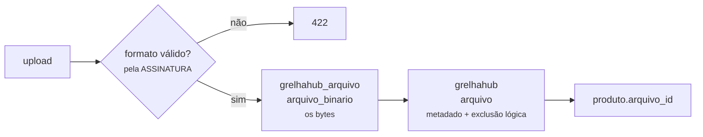

# ADR-0018 — Imagem como binário no banco, servida em base64

| Campo | Valor |
|-------|-------|
| Situação | **Aceita** |
| Data | 18/08/2026 |
| Decide sobre | `RN-VEN-042` (imagem do produto), `RN-GER-026` (logo da unidade) |
| Relacionada | [ADR-0017](0017-tres-bancos-aplicacao-arquivo-e-log.md) |
| **Substitui** | [ADR-0015](0015-armazenamento-de-imagem.md) — imagem em volume de disco |

---

## Contexto

O [ADR-0015](0015-armazenamento-de-imagem.md) colocou a imagem num **volume de disco** montado no
contêiner, servida pelo Nginx. A decisão estava certa para o que se sabia então, e três coisas
mudaram desde ela.

**1. Arquivo em disco não tem transação.** Gravar o arquivo e gravar a linha do produto são duas
operações sem nada em comum. As duas falhas possíveis são silenciosas:

- arquivo gravado, transação desfeita → **arquivo órfão**, ocupando disco para sempre, sem ninguém
  sabendo que existe;
- linha gravada apontando para um arquivo que não gravou → **imagem quebrada** no cardápio público.

**2. `RN-GER-002` diz que nada transacional é excluído fisicamente** — e o arquivo em disco não
sabe disso. Produto desativado deixava o arquivo lá; produto reativado dependia de o arquivo ainda
existir. A exclusão lógica parava na borda do sistema de arquivos.

**3. Backup em duas peças.** O `dump` do banco não leva as imagens. Restaurar o banco sem restaurar
o volume devolve um cardápio de molduras vazias — e ninguém percebe até um cliente abrir a vitrine.

## Decisão

> **O binário vai para o banco `grelhahub_arquivo`, o metadado vai para a tabela `arquivo` do banco
> da aplicação, e a imagem é entregue ao cliente em base64.**

### Por que o metadado fica no banco da aplicação

É ele que participa das regras: pertence a uma unidade (`RN-GER-009`), tem exclusão lógica
(`RN-GER-002`), entra na trilha de auditoria. O binário não tem regra nenhuma — é um monte de
bytes com um identificador.

Isso também mantém o **`JOIN` que importa**: `produto → arquivo` é uma consulta só, no mesmo banco.
Só a busca dos bytes atravessa para o outro, e ela acontece uma vez por imagem, não por listagem.

### A ordem de gravação, e por que ela é essa

**Binário primeiro, metadado depois.** Invertida, uma falha deixaria metadado apontando para bytes
que não existem — imagem quebrada na vitrine, que é a falha visível. Nesta ordem, a falha possível
é um binário sem metadado: **invisível para o sistema e removível por varredura**, porque o banco
de arquivo sabe quais ids nenhum metadado referencia.

⚠ É a mesma escolha do ADR-0016 para e-mail: quando não há transação, **falhe do lado que não
mente para o usuário**.

## O custo do base64, declarado

Base64 cresce o payload em **≈33%** e desliga o cache de imagem do navegador — a foto volta a
trafegar em toda carga da vitrine, dentro do JSON, sem `ETag` e sem `Cache-Control` próprios.

Aceito porque o volume é o do ADR-0015 e não mudou: **dezenas de produtos por casa**, imagem já
limitada por `RN-VEN-042`. E o que se compra com isso é a transação, a exclusão lógica e o backup
em uma peça só.

⚠ **Onde isto vai doer primeiro:** o cardápio público de uma casa com muitas fotos. Se acontecer, a
saída **não** é voltar para o disco — é servir a imagem por uma rota própria, com `ETag` derivado
do id do arquivo (que é imutável) e `Cache-Control` longo. O binário continua no banco; muda só a
entrega. Está registrado aqui para que a próxima pessoa não refaça a análise.

## Consequências

### Positivas

- **Uma transação.** Ou o produto e a imagem existem, ou nenhum dos dois.
- **Exclusão lógica de verdade** — o metadado tem `dh_exclusao` como qualquer registro transacional.
- **Backup em uma peça.** Restaurou o banco, restaurou o cardápio.
- **Sem arquivo órfão invisível**: o que sobra é detectável por consulta.
- **Isolamento por unidade** vale para a imagem como vale para o resto.

### Negativas

- **+33% de tráfego** e sem cache de imagem — mitigação registrada acima.
- **O `dump` do banco de arquivo é grande.** É por isso que ele é um banco separado (ADR-0017).
- O Nginx deixa de servir a imagem: ela passa pela API. Uma requisição a mais no caminho.

## O que **não** muda

- A validação continua **pela assinatura do arquivo, nunca pela extensão** (`RN-VEN-042`).
- O nome recebido do usuário **nunca** é usado — agora nem chega a existir nome no disco.
- Tamanho e formato continuam limitados pelas mesmas regras.

## Migração do que já existe

As imagens gravadas em disco pelo ADR-0015 **não são migradas automaticamente**. O ambiente ainda
não tem cliente em produção com foto cadastrada; havendo, a migração é uma varredura do volume
gravando cada arquivo pelo caminho novo. Registrado para não virar descoberta.
