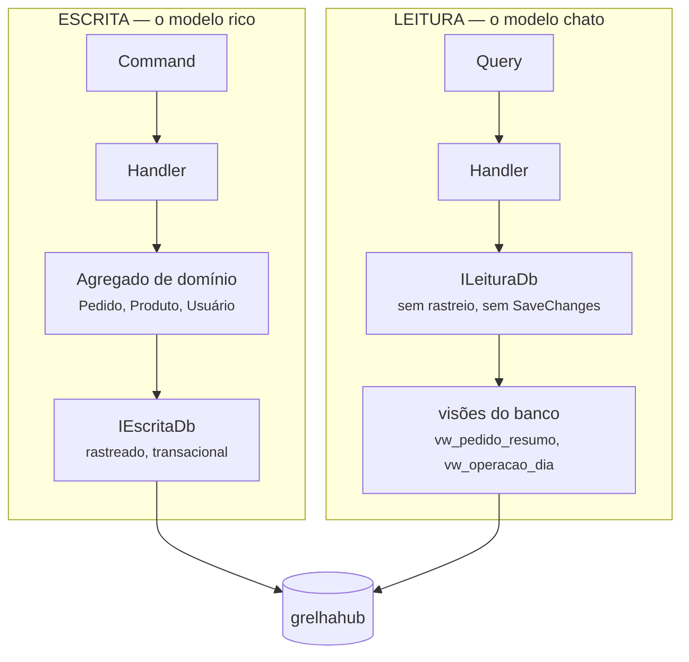

# ADR-0019 — CQRS de verdade: modelo de leitura próprio, separado do de escrita

| Campo | Valor |
|-------|-------|
| Situação | **Aceita e concluída** — 16 de 16 consultas convertidas em 18/08/2026 |
| Data | 18/08/2026 |
| Decide sobre | Separação leitura/escrita em toda a camada de aplicação |
| **Emenda** | [ADR-0002](0002-clean-architecture-com-cqrs.md) — que adotou a sigla sem a separação |
| Relacionada | [ADR-0009](0009-onde-as-regras-de-negocio-vivem.md), [ADR-0017](0017-tres-bancos-aplicacao-arquivo-e-log.md) |

---

## Contexto

O [ADR-0002](0002-clean-architecture-com-cqrs.md) declarou "Clean Architecture + CQRS". O que foi
construído, conferido no código em 18/08/2026, é **CQS** — *Command Query Separation*:

| Marcador de CQRS | Existe? |
|------------------|---------|
| Tipos separados para comando e consulta, com handler próprio | ✔ 33 comandos, 16 consultas |
| Modelo de **leitura** separado do de escrita | ✘ o mesmo `IAppDbContext` nos 28 handlers |
| Store de leitura próprio | ✘ |
| Eventos sincronizando os dois lados | ✘ |

A separação existe no **nome do tipo** e para de existir na linha seguinte: a consulta abre o mesmo
contexto, carrega a mesma entidade de domínio e projeta um DTO na memória. Três consequências que
já apareceram no código:

1. **A consulta carrega agregado que não vai usar.** O painel de operação traz `Pedido` com
   `Itens` para somar dois números.
2. **O EF não traduz value object.** `Sum(i => i.PrecoPraticado.Valor * i.Quantidade)` não vira
   SQL — está escrito no `CLAUDE.md` como armadilha conhecida, e a saída recomendada ali já era
   *view*. A regra existia; faltava o lugar para pô-la.
3. **Mudança de escrita quebra leitura sem aviso.** Renomear uma propriedade do agregado quebra
   toda consulta que a projetava, porque as duas leem o mesmo modelo.

E há o argumento de banca: **declarar CQRS e entregar CQS é uma divergência entre documento e
código** — exatamente o que este projeto existe para não fazer.

## Decisão

> **A leitura ganha modelo próprio.** Consulta não toca em entidade de domínio, não usa o contexto
> de escrita, e lê de **visões do banco** projetadas em tipos sem chave, criados para a tela que os
> consome.

### As três regras que definem a separação

1. **Handler de `Query` não enxerga `IEscritaDb`.** Nem por injeção — a interface não é registrada
   para ele.
2. **Handler de `Command` não enxerga `ILeituraDb`.** Escrita que lê da visão leria dado possivelmente
   desatualizado para decidir regra.
3. **`ILeituraDb` não tem `SaveChanges`.** Não é disciplina: o método não existe na interface.

### O mesmo banco, e por que isso ainda é CQRS

O [ADR-0002](0002-clean-architecture-com-cqrs.md) descartou "bancos separados com event sourcing",
e **esse descarte continua de pé**: consistência eventual entre escrita e leitura é exatamente o
que um caixa não tolera.

O que se separa aqui é o **modelo**, não a instância. Ler de uma visão do mesmo banco dá:

- **consistência imediata** — a visão enxerga a linha no instante em que a transação fecha;
- **zero sincronização** — não há projeção para manter, nem fila, nem defasagem;
- **liberdade de otimizar a leitura** sem tocar no agregado.

E deixa a porta aberta: se um dia a leitura precisar de outra instância, o que muda é a *connection
string* de `ILeituraDb`. Nenhum handler de consulta muda.

### A visão é o mecanismo que o catálogo já preferia

O [ADR-0009](0009-onde-as-regras-de-negocio-vivem.md) fixa a ordem `MOD → constraints → GEN → TRG →
VW → APP`, com a aplicação em último. Somar em memória, no handler, é o **último** lugar da lista.
A visão é o penúltimo — e o correto para agregação.

### Sem pacote novo

A leitura usa **tipos sem chave do EF Core** mapeados às visões. Um micro-ORM traria a separação
com uma dependência a mais e uma segunda forma de escrever SQL no projeto; o que se ganharia é
sintaxe, e o que se perderia é uma coisa a menos para manter.

## A separação é verificada, não combinada

⚠ **Um teste de arquitetura falha o build se a regra for quebrada.** Ele varre os handlers por
reflexão e recusa:

- handler de `Query` que dependa do contexto de escrita;
- handler de `Command` que dependa do contexto de leitura;
- entidade de domínio aparecendo no tipo de retorno de uma `Query`.

É o mesmo desenho de `GarantirAusenciaDeDecimalCru`, que já recusa o modelo na partida quando
alguém guarda dinheiro num tipo solto. **Separação combinada em reunião volta em três meses;
separação verificada, não.**

## Consequências

### Positivas

- **A consulta lê o que a tela precisa** — nada de agregado carregado para somar dois campos.
- **Agregação vai para o banco**, que é onde o ADR-0009 já mandava.
- **Mudar o agregado não quebra a leitura em silêncio**: quebra a visão, que é um objeto nomeado.
- A separação passa a ser **demonstrável** — e é isso que uma banca pede.

### Negativas

- **Uma visão por tela**, e visão é esquema: entra em migration, precisa de nome e de manutenção.
- **Duplicação aparente.** O mesmo campo aparece no agregado e na visão. Não é duplicação de
  verdade — é a diferença entre "o que o negócio garante" e "o que a tela mostra" —, mas parece,
  e quem revisar vai perguntar.
- **A conversão é grande**: 16 consultas mudaram de forma, e com elas 17 visões entraram no
  esquema.
- **Uma regra de domínio precisou ser EXTRAÍDA** para poder ser respondida dos dois lados — ver
  abaixo. É o custo real que a conversão cobrou, e vale registrar porque ele vai voltar.

## Migração

Feita agora, **antes de haver cliente em produção**, e é o motivo de ser agora: converter consulta
com base rodando exigiria compatibilidade dos dois lados ao mesmo tempo.

Por consulta, e não em bloco: cada uma ganha a sua visão, o handler passa a lê-la, e o teste de
integração daquela consulta continua verde — é ele que prova que a leitura nova devolve o mesmo que
a antiga.

### A catraca, e por que ela ficou

A conversão saiu em duas levas — venda primeiro (5 visões), cadastro depois (12). Entre uma e
outra, o inventário das consultas ainda não convertidas viveu **dentro do teste**,
em `SeparacaoDeCqrsTests.PendentesDeConversao`, e dois testes o mantinham honesto:

- um recusa infrator que **não** esteja na lista → a dívida não cresce;
- outro recusa nome na lista que **já** foi convertido → a lista não apodrece.

Sem o segundo, a lista viraria papel de parede: nomes convertidos ficariam nela para sempre, e a
próxima pessoa leria "15 pendentes" quando restassem três.

⚠ **A lista continua no código, vazia.** Apagá-la junto com o inventário devolveria a porta que ela
fechou: o primeiro handler novo que abrisse o contexto de escrita numa `Query` não teria onde ser
anotado, e a discussão viraria "acrescento uma exceção aqui?" em vez de "por que esta consulta
precisa do agregado?".

### ⚠⚠ O que a conversão cobrou: regra de domínio que a leitura também precisa

Duas perguntas do cardápio público **não são projeção** — são regra:

| Pergunta | Regra |
|----------|-------|
| "a casa está aberta agora?" | `RN-VEN-048`, com conversão para o fuso da casa e turno que atravessa a meia-noite |
| "qual é o endereço em uma linha?" | `RN-GER-037` |

As duas viviam dentro do agregado `Unidade`, e o handler convertido não carrega agregado. Havia
três saídas:

1. **reescrever em SQL, dentro da visão** — duas implementações da mesma regra, divergindo em
   silêncio. É exatamente o defeito que `DiaOperacionalParidadeTests` existe para pegar, e ele só
   pega porque alguém escreveu o teste de paridade;
2. **manter estas consultas fora da conversão** — a catraca com dois nomes para sempre;
3. **extrair a função pura** para `ApresentacaoDaCasa`, que o agregado passa a chamar e a leitura
   também.

Escolhida a terceira. Não há paridade a manter: **é o mesmo código, com dois chamadores**. O teste
de `ApresentacaoDaCasa` cobre os dois.

> A generalização vale para o resto do sistema: **quando a leitura precisa de uma regra, extraia a
> função — não a traduza.** Tradução cria a segunda verdade que ninguém compara.
