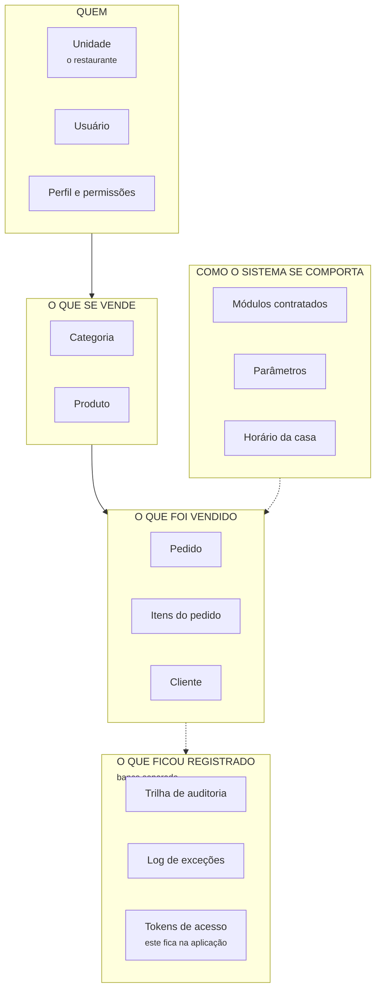
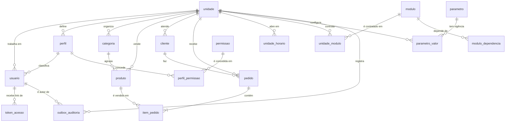
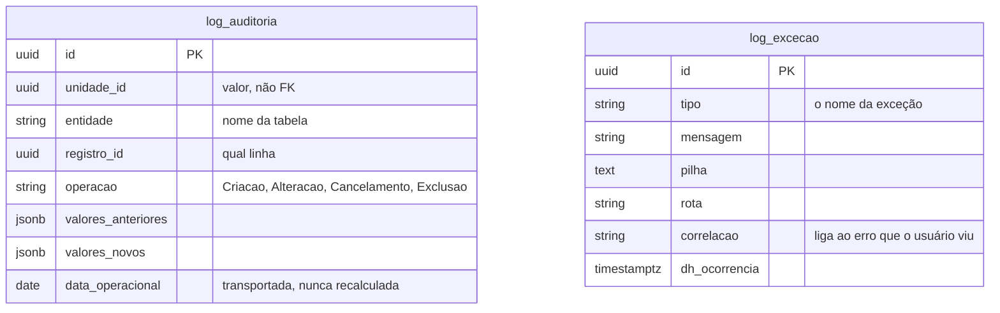

# 01 — Modelo de dados

> **Extraído do modelo real do sistema em 18/08/2026 (segunda extração do dia).**
> **Três bancos** — 18 tabelas na aplicação com 13 relacionamentos, 2 no banco de log, 5 visões de
> leitura.
> Nada aqui foi escrito de memória: os tipos, as chaves e os índices vieram do snapshot do
> mapeamento objeto-relacional.

---

## Parte 1 — Para entender sem ser técnico

### O que o sistema guarda, em cinco grupos



- **Quem** — o restaurante, as pessoas que trabalham nele e o que cada uma pode fazer.
- **O que se vende** — o cardápio: categorias e produtos, com preço.
- **O que foi vendido** — o pedido, seus itens e o cliente que pediu.
- **Como o sistema se comporta** — o que a casa contratou, quanto é a taxa de entrega, que horas
  abre. É o que muda de casa para casa **sem mudar o código**.
- **O que ficou registrado** — quem alterou o quê, e o que quebrou. ⚠ **Estes vivem num banco
  próprio** — `grelhahub_log`, ADR-0017: crescem a cada gravação e têm retenção diferente do resto.

### As três ideias que explicam quase tudo

#### 1. Tudo pertence a uma unidade

Quase toda tabela tem uma coluna `unidade_id`. É ela que garante que **um restaurante nunca vê o
dado do outro**. Não é um filtro que o programador lembra de escrever: é uma trava aplicada
automaticamente em toda consulta.

O pedido nº 1 da Brasa da Esquina e o pedido nº 1 da Hamburgueria do João **são dois pedidos
diferentes com o mesmo número** — e isso é de propósito: o número é para o cliente ler em voz alta,
não para o sistema identificar.

#### 2. Nada transacional é apagado

Pedido cancelado continua no banco, com o motivo. Usuário desligado continua no banco, marcado como
inativo. Apagar destruiria o histórico e o relatório do mês passado mudaria sozinho.

#### 3. O preço é copiado na venda

Quando alguém pede um X-Burger de R$ 28,00, o sistema **copia** o nome e o preço para dentro do
item do pedido. Se amanhã o X-Burger virar R$ 32,00, o pedido de ontem continua valendo R$ 28,00.

> Sem isso, aumentar um preço reescreveria o faturamento do mês inteiro.

### A coluna que o banco calcula sozinho

O pedido tem uma coluna chamada `data_operacional` que **ninguém preenche**. O banco a calcula no
momento em que a linha nasce, com esta conta:

```
data_operacional = (momento da criação, no fuso da casa) − (hora de virada da casa)
```

Uma casa que fecha às 3h da manhã tem virada às 3h. Um pedido feito à 1h30 de domingo cai em
**sábado**. E o pedido guarda a virada e o fuso **que valiam no dia em que ele nasceu** — mudar o
horário da casa amanhã **não reclassifica** o faturamento de ontem.

---

## Parte 2 — O diagrama de relacionamentos (DER)

Cada seta aponta do **filho** para o **pai**: "todo produto pertence a uma categoria".



### O banco de log, separado — ADR-0017

Ele **não tem relacionamento com o diagrama acima**, e isso é a consequência mais visível da
separação: não existe `JOIN` entre a trilha e o dado operacional. A trilha guarda `unidade_id`,
`entidade` e `registro_id` como **valores**, não como chaves estrangeiras — quem quer saber "quem
alterou este pedido" faz duas consultas, em dois bancos.



> ⚠ **`data_operacional` na trilha é coluna comum aqui, não calculada.** No banco da aplicação o
> PostgreSQL a calcula a partir do fuso e da virada da própria linha. Neste banco não existem
> `unidade` nem `pedido` para consultar — o valor chega pronto. Recalcular aqui seria uma segunda
> definição da mesma regra, e das piores: divergiria em silêncio.

### Como ler as cardinalidades

| Símbolo | Lê-se |
|---------|-------|
| `\|\|--o{` | **Um para muitos, opcional** — uma unidade pode ter zero ou muitos usuários |
| `\|\|--\|{` | **Um para muitos, obrigatório** — todo pedido tem **pelo menos um** item |

### As duas tabelas que ligam duas coisas

`perfil_permissao` e `modulo_dependencia` não guardam informação própria: existem só para ligar. A
chave primária delas é **o par**, e não um `id` — é o que impede a mesma permissão de ser concedida
duas vezes ao mesmo perfil.

---

## Parte 3 — Dicionário de dados

**Legenda:** 🔑 chave primária · 🔗 chave estrangeira · ⭘ pode ficar vazio · ⚙ calculada pelo banco

### Grupo 1 — Quem

#### `unidade` — o restaurante

| Coluna | Tipo | | O que guarda |
|--------|------|---|--------------|
| `id` | `uuid` | 🔑 | Identificador |
| `razao_social` | `varchar(200)` | | Nome jurídico |
| `nome_fantasia` | `varchar(200)` | | Nome que o cliente vê |
| `cnpj` | `varchar(14)` | | Só dígitos. **Único no sistema inteiro** |
| `slug` | `varchar(60)` | | O endereço público: `/c/brasa-da-esquina`. **Único** |
| `telefone` | `varchar(11)` | ⭘ | Só dígitos |
| `ativa` | `boolean` | | Casa inativa não vende e ninguém dela entra |
| `fuso_horario` | `varchar(50)` | | `America/Sao_Paulo`. Entra no cálculo do dia operacional |
| `hora_virada_operacional` | `interval` | | Quando o "dia" da casa vira. Padrão: 4 horas |
| `cep` `logradouro` `numero_endereco` `complemento` `bairro` `cidade` `uf` | vários | ⭘ | Endereço em campos separados — a primeira pergunta de logística vai precisar do bairro isolado |
| `url_logo` | `varchar(500)` | ⭘ | A logo mostrada na vitrine |
| `dh_criacao` | `timestamptz` | | Quando foi cadastrada |

#### `usuario` — quem trabalha

| Coluna | Tipo | | O que guarda |
|--------|------|---|--------------|
| `id` | `uuid` | 🔑 | |
| `unidade_id` | `uuid` | 🔗 ⭘ | **Vazio para usuário de plataforma** — quem opera o produto não pertence a restaurante nenhum |
| `perfil_id` | `uuid` | 🔗 ⭘ | Vazio para usuário de plataforma, pelo mesmo motivo |
| `nome` / `sobrenome` | `varchar(200)` | | |
| `cpf` | `char(11)` | ⭘ | Só dígitos. **Único no sistema** |
| `email` | `varchar(200)` | | **Único no sistema.** É por ele que se entra |
| `senha_hash` | `varchar(500)` | | ⚠ **Nunca a senha** — só o resultado irreversível dela |
| `deve_trocar_senha` | `boolean` | | Senha escolhida por outra pessoa não é senha |
| `eh_plataforma` | `boolean` | | Se é da equipe GrelhaHub |
| `ativo` | `boolean` | | Desligado, não excluído |

#### `perfil` — o cargo

| Coluna | Tipo | | O que guarda |
|--------|------|---|--------------|
| `id` | `uuid` | 🔑 | |
| `unidade_id` | `uuid` | 🔗 | Cada casa tem os seus |
| `nome` | `varchar(60)` | | Administrador, Gerente, Atendente, Cozinha, Operador, Entregador. **Único por unidade** |
| `descricao` | `varchar(200)` | | O que ele faz, em português |
| `sistema` | `boolean` | | Perfil do sistema não pode ser renomeado nem excluído |

#### `permissao` — a capacidade

| Coluna | Tipo | | O que guarda |
|--------|------|---|--------------|
| `id` | `uuid` | 🔑 | |
| `codigo` | `varchar(60)` | | `pedido.cancelar`, `custo.visualizar`. **Único** |
| `descricao` | `varchar(200)` | | O que ela permite, em português — é o que aparece na tela |
| `modulo` | `varchar(3)` | | A que módulo pertence: `GER`, `VEN` |

#### `perfil_permissao` — quem tem o quê

| Coluna | Tipo | | |
|--------|------|---|---|
| `perfil_id` | `uuid` | 🔑 🔗 | |
| `permissao_id` | `uuid` | 🔑 🔗 | A chave é **o par** |

### Grupo 2 — O que se vende

#### `categoria`

| Coluna | Tipo | | O que guarda |
|--------|------|---|--------------|
| `id` | `uuid` | 🔑 | |
| `unidade_id` | `uuid` | 🔗 | |
| `nome` | `varchar(200)` | | **Único por unidade** |
| `ordem` | `integer` | | Em que posição aparece no cardápio |
| `ativa` | `boolean` | | Categoria inativa some da vitrine — **e continua na gestão**, senão os produtos ficariam presos num grupo invisível |

#### `produto`

| Coluna | Tipo | | O que guarda |
|--------|------|---|--------------|
| `id` | `uuid` | 🔑 | |
| `unidade_id` | `uuid` | 🔗 | |
| `categoria_id` | `uuid` | 🔗 | |
| `nome` | `varchar(200)` | | **Único por unidade** |
| `descricao` | `varchar(500)` | ⭘ | |
| `preco` | `numeric(12,2)` | | ⚠ **Dinheiro nunca é decimal solto** — duas casas, sempre |
| `ativo` | `boolean` | | Situação **cadastral**: o produto saiu do cardápio |
| `disponivel` | `boolean` | | Situação **do turno**: acabou o ingrediente hoje |
| `url_imagem` | `varchar(500)` | ⭘ | |

> ⚠ **`ativo` e `disponível` não são o mesmo campo com dois nomes.** O efeito para o cliente é
> idêntico — o produto não aparece — e é por isso que fundi-los é tentador. Mas "saiu do cardápio"
> e "acabou hoje" são decisões de pessoas diferentes, em momentos diferentes.

### Grupo 3 — O que foi vendido

#### `pedido`

| Coluna | Tipo | | O que guarda |
|--------|------|---|--------------|
| `id` | `uuid` | 🔑 | Identidade real |
| `unidade_id` | `uuid` | 🔗 | |
| `cliente_id` | `uuid` | 🔗 ⭘ | |
| `numero` | `integer` | | O número que o cliente lê. **Reinicia a cada dia operacional e se repete entre casas** |
| `data_operacional` | `date` | ⚙ | **Calculada pelo banco.** O dia que este pedido pertence |
| `fuso_operacional` | `varchar(50)` | | Cópia do fuso da casa **no instante do pedido** |
| `hora_virada_operacional` | `interval` | | Cópia da virada da casa **no instante do pedido** |
| `status` | `integer` | | Aberto → Confirmado → Em produção → Pronto → Entregue → Finalizado, ou Cancelado |
| `canal` | `integer` | | Por onde entrou: delivery próprio, balcão, mesa |
| `observacao` | `varchar(500)` | ⭘ | "sem cebola" |
| `dh_criacao` | `timestamptz` | | |
| `dh_confirmacao` / `dh_finalizacao` | `timestamptz` | ⭘ | |
| `motivo_cancelamento` | `varchar(500)` | ⭘ | Cancelar **exige** motivo |
| `dh_exclusao` / `excluido_por_usuario_id` / `motivo_exclusao` | vários | ⭘ | Exclusão lógica: some das telas, fica no banco |

> ⚠ **Por que o pedido copia o fuso e a virada da casa?** Porque relatório fechado não pode mudar
> sozinho. Se a casa passar a fechar às 5h, os pedidos antigos continuam classificados pela régua
> que valia quando nasceram. É o mesmo princípio do preço copiado.

#### `item_pedido`

| Coluna | Tipo | | O que guarda |
|--------|------|---|--------------|
| `id` | `uuid` | 🔑 | |
| `unidade_id` | `uuid` | 🔗 | |
| `pedido_id` | `uuid` | 🔗 | |
| `produto_id` | `uuid` | 🔗 | Aponta para o cardápio — mas **não é dele que o valor sai** |
| `nome_produto` | `varchar(200)` | | **Cópia** do nome no momento da venda |
| `preco_praticado` | `numeric(12,2)` | | **Cópia** do preço no momento da venda |
| `quantidade` | `integer` | | ⚠ Inteiro: são **dois lanches**, não 2,0000 lanches |
| `observacao` | `varchar(300)` | ⭘ | |

#### `cliente`

| Coluna | Tipo | | O que guarda |
|--------|------|---|--------------|
| `id` | `uuid` | 🔑 | |
| `unidade_id` | `uuid` | 🔗 | |
| `nome` | `varchar(200)` | | |
| `telefone` | `varchar(11)` | | Só dígitos. **Único por unidade** — é ele que identifica o cliente |

### Grupo 4 — Como o sistema se comporta

#### `modulo` e `unidade_modulo`

| `modulo` | Tipo | | O que guarda |
|----------|------|---|--------------|
| `id` | `uuid` | 🔑 | |
| `codigo` | `varchar(3)` | | `GER`, `VEN`, `EST`. **Único** |
| `nome` | `varchar(60)` | | |
| `nucleo` | `boolean` | | Módulo de núcleo não se desliga |
| `ordem` | `smallint` | | Ordem no menu |

| `unidade_modulo` | Tipo | | O que guarda |
|------------------|------|---|--------------|
| `id` | `uuid` | 🔑 | |
| `unidade_id` / `modulo_id` | `uuid` | 🔗 | |
| `vigencia_inicio` / `vigencia_fim` | `timestamptz` | | **Contratação tem vigência** — dá para responder "o que esta casa tinha contratado em março" |
| `justificativa` | `varchar(500)` | ⭘ | |

`modulo_dependencia` liga módulo a módulo: Vendas depende de Gerais, Estoque depende de Produção.
Uma restrição do banco impede que um módulo dependa de si mesmo.

#### `parametro` e `parametro_valor`

Parâmetro é o que muda de casa para casa **sem mudar o código**: taxa de entrega, teto de desconto,
tempo de preparo.

| `parametro_valor` | Tipo | | O que guarda |
|-------------------|------|---|--------------|
| `id` | `uuid` | 🔑 | |
| `unidade_id` / `parametro_id` | `uuid` | 🔗 | |
| `valor` | `varchar(50)` | | |
| `vigencia_inicio` / `vigencia_fim` | `timestamptz` | | **Valor nunca é sobrescrito** — a vigência anterior é fechada e uma nova nasce |
| `justificativa` | `varchar(500)` | ⭘ | |

> Isso é o que permite explicar um cálculo do mês passado: a leitura é sempre **na data do evento**,
> não no valor de hoje.

#### `unidade_horario`

| Coluna | Tipo | | O que guarda |
|--------|------|---|--------------|
| `id` | `uuid` | 🔑 | |
| `unidade_id` | `uuid` | 🔗 | |
| `dia_semana` | `integer` | | 0 = domingo. **Único por unidade + dia** |
| `abre` / `fecha` | `time` | ⭘ | Vazio = fechado nesse dia |

É deste cadastro que sai a **hora de virada** da unidade: o fechamento que atravessa a meia-noite
mais tarde da semana.

### Grupo 5 — O que ficou registrado

#### `outbox_auditoria` — a ponte, no banco da aplicação

A trilha **nasce aqui**, dentro da transação da operação, e é levada para o banco de log por um
serviço em segundo plano. É **fila, não histórico**: esvazia sozinha, e só cresce quando o banco de
log está fora do ar.

| Coluna | Tipo | | O que guarda |
|--------|------|---|--------------|
| `id` | `uuid` | 🔑 | **O mesmo id que a linha terá no banco de log** — é ele que impede a cópia dupla |
| `unidade_id` / `usuario_id` | `uuid` | ⭘ | Quem fez |
| `entidade` / `registro_id` | | | Em que tabela e em qual linha |
| `operacao` | `varchar(20)` | | `Criacao`, `Alteracao`, `Cancelamento`, `Exclusao` |
| `valores_anteriores` / `valores_novos` | `jsonb` | ⭘ | O antes e o depois |
| `data_operacional` | `date` | | Calculada no banco da aplicação e **transportada** |
| `dh_enfileiramento` | `timestamptz` | | A fila é lida do mais antigo para o mais novo |
| `tentativas` / `ultimo_erro` | | ⭘ | ⚠ A linha **nunca** é descartada por excesso de tentativas — trilha perdida é o que a ponte existe para impedir. O contador serve para o alerta |

> ⚠ **As validações ficam na ENTRADA da ponte**, não na saída: `ck_outbox_operacao` e
> `ck_outbox_valores` recusam lixo aqui. Uma linha impossível que passasse ficaria entupindo a fila,
> bloqueando tudo atrás dela.

#### `log_auditoria` — a trilha, no banco de log

Mesmas colunas do quadro acima, do outro lado da ponte.

> ⚠ **A trilha é imutável, e o banco impõe isso.** Um gatilho **recusa** qualquer `UPDATE` ou
> `DELETE`, e outro recusa esvaziar a tabela — porque `TRUNCATE` não dispara gatilho de linha, e é
> justamente o comando que apagaria tudo de uma vez. Trilha que o próprio sistema pode reescrever
> não é trilha.
>
> Os dois gatilhos **atravessaram a mudança de banco**. Sem recriá-los do outro lado, a trilha
> passaria a aceitar alteração em silêncio.

#### `log_excecao` — o que quebrou

Antes disto, o vestígio de uma falha em produção era a saída de log do contêiner — que o reinício
apaga. Agora dá para perguntar **"o que mais quebrou esta semana"** com uma consulta.

| Coluna | Tipo | | O que guarda |
|--------|------|---|--------------|
| `tipo` | `varchar(200)` | | O nome da exceção — é por ele que se agrupa |
| `mensagem` / `pilha` | | | A pilha não tem teto: truncá-la corta o quadro que diz onde quebrou |
| `rota` / `metodo` / `status_http` | | ⭘ | |
| `unidade_id` / `usuario_id` | `uuid` | ⭘ | ⚠ **Opcionais de propósito** — boa parte das falhas acontece antes de existir unidade no contexto (login, rota anônima). Exigi-las deixaria as falhas mais externas sem onde ser gravadas |
| `correlacao` | `varchar(100)` | ⭘ | O identificador da requisição. **É por ele que o suporte liga esta linha ao erro que o usuário viu** |

#### `token_acesso` — os links de acesso

Guarda os links de convite e de "esqueci minha senha", e **apenas o hash** do token: quem lê a
tabela não consegue entrar na conta de ninguém. Emitir um novo invalida o anterior.

> ⚠ **`sessao_suporte` não existe mais** (ADR-0020). Ela exigia que a equipe GrelhaHub abrisse uma
> sessão com motivo antes de escrever no dado de um cliente — um portão aberto por quem ele deveria
> conter. O controle passou a ser a trilha, que sempre foi o mecanismo forte.

---

## Parte 3.1 — As visões de leitura — ADR-0019

A **consulta** não lê as tabelas acima: lê visões feitas para a tela que as consome. É onde a
agregação mora, e o motivo é o mesmo que faz o resto do sistema preferir o banco à aplicação.

| Visão | Responde |
|-------|----------|
| `vw_pedido_resumo` | Uma linha por pedido, com o total **já somado** e a contagem de itens |
| `vw_pedido_item` | Os itens, com o total da linha calculado |
| `vw_operacao_dia` | Faturamento, contagem e valor em andamento por (unidade, dia operacional) |
| `vw_produto_vendido` | Quanto de cada produto saiu — agrupado pelo **nome praticado na venda** |
| `vw_autor` | Id e nome, só para dizer quem fez algo na trilha |

> ⚠⚠ **Toda visão recortada por unidade expõe `unidade_id`**, e o contexto de leitura recusa mapear
> uma que não a tenha. Vazamento entre restaurantes na **leitura** é invisível: o número continua
> plausível, só que somando a casa do vizinho.
>
> ⚠ **`vw_autor` é a exceção declarada** — ela **não** é recortada. O autor de um registro pode ser
> usuário de plataforma, que não tem unidade; filtrar ali exibiria um traço no lugar do nome de quem
> mexeu, justamente no caso que mais importa auditar. Por isso ela carrega **só id e nome**.
>
> ⚠ **A exclusão lógica é repetida no SQL das visões.** O filtro automático que esconde registro
> excluído vale para o modelo de escrita e **não alcança visão** — é o `WHERE dh_exclusao IS NULL`
> dentro de cada uma que faz o pedido excluído sumir da leitura.

---

## Parte 4 — O que o banco garante sozinho

O sistema valida em **duas camadas**, deliberadamente:

> O banco garante que o dado nunca fica inválido. A aplicação garante que o usuário nunca chega até
> lá — e é ela que escreve a mensagem de erro em português.

| Mecanismo | Onde aparece | O que garante |
|-----------|--------------|---------------|
| **Chave única** | `unidade.cnpj`, `usuario.email`, `usuario.cpf`, `unidade.slug` | Não existem dois |
| **Chave única composta** | `pedido (unidade, dia operacional, número)` | O número do pedido não repete no mesmo dia da mesma casa |
| **Coluna calculada** | `pedido.data_operacional`, `log_auditoria.data_operacional` | A regra do dia operacional não depende de ninguém lembrar |
| **Restrição de valor** | `ck_modulo_codigo`, `ck_parametro_tipo`, `ck_log_operacao` | O código do módulo tem duas ou três letras maiúsculas; a operação da trilha é uma das três |
| **Restrição contra ciclo** | `ck_modulo_dependencia_ciclo` | Um módulo não depende de si mesmo |
| **Gatilho** | `trg_log_auditoria_imutavel` **no banco de log** | Ninguém altera nem apaga a trilha |
| **Restrição na ponte** | `ck_outbox_operacao`, `ck_outbox_valores` | Lixo é recusado na ENTRADA, e não entope a fila |
| **Exclusão por vigência** | `ex_parametro_valor_vigencia`, `ex_unidade_modulo_vigencia` | Dois valores do mesmo parâmetro não valem ao mesmo tempo |

### Índices que existem por um motivo

Todo índice de tabela transacional **começa por `unidade_id`**. Não é estética: é o que faz a
consulta de um restaurante não varrer o dado dos outros.

| Índice | Para que |
|--------|----------|
| `pedido (unidade, dia operacional, número)` — único | Numeração diária, e a busca por número |
| `pedido (unidade, dia operacional, status)` | O painel: "os pedidos abertos de hoje" |
| `log_auditoria (unidade, entidade, registro, ocorrência)` | "O que aconteceu com este pedido" |
| `token_acesso (hash)` — único | Achar o link em uma leitura |

---

## Parte 5 — Como este documento foi gerado

As tabelas acima vieram do **snapshot do mapeamento objeto-relacional** — o mesmo arquivo que o
sistema usa para criar o banco. As restrições e gatilhos vieram das **migrations**. Isso significa
que, se o código mudar e este documento não for regerado, a diferença é detectável: basta comparar
com o snapshot.

**Fontes:** `backend/src/GrelhaHub.Infrastructure/Persistence/Migrations/GrelhaHubDbContextModelSnapshot.cs`
e o diretório de migrations ao lado.
