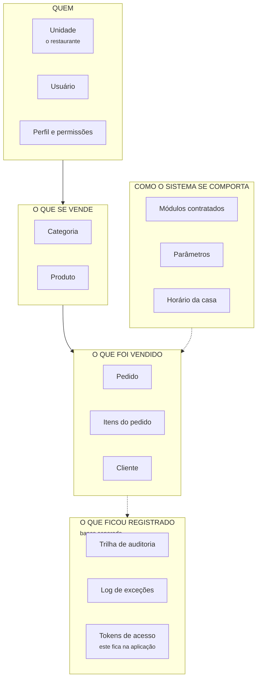
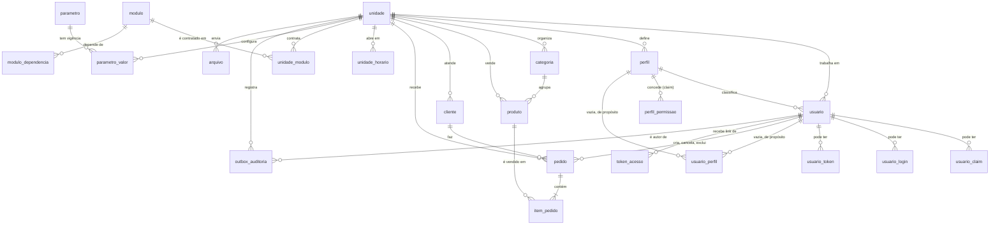
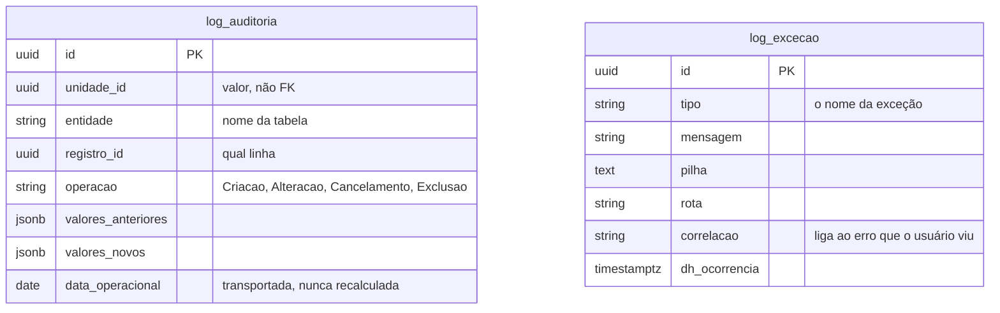
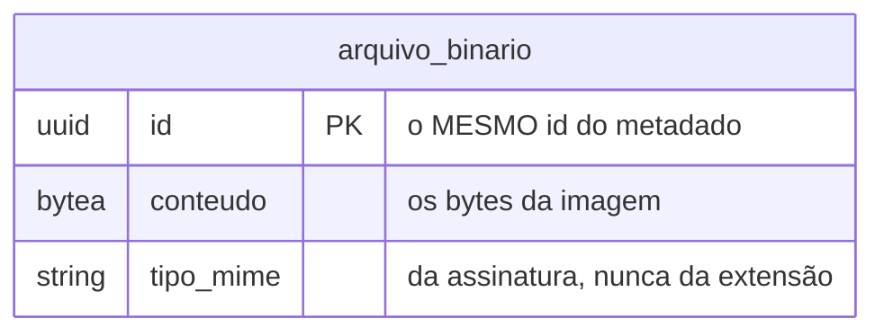

# 01 — Modelo de dados

> **Extraído do modelo real do sistema em 19/08/2026 — a extração que acompanha a ADR-0022.**
> **Três bancos** — 22 tabelas e 1 visão materializada na aplicação, 2 tabelas no banco de log,
> 1 no banco de arquivo, e 17 visões de leitura.
> Nada aqui foi escrito de memória: os tipos, as chaves e os índices vieram da migration
> `Fundacao` e do snapshot do mapeamento objeto-relacional.

> ⚠⚠ **Em 19/08/2026 o modelo de acesso migrou para o ASP.NET Core Identity (ADR-0022), e o banco
> foi reconstruído do zero: 20 migrations viraram uma** — a `Fundacao`, autorizada pelo dono do
> produto porque o projeto não está em produção. O que mudou de forma visível: `usuario` e `perfil`
> ganharam as colunas do Identity (com nome em português — **nenhum `AspNet*` chega ao banco**),
> a tabela `permissao` **deixou de existir** (a concessão virou claim de papel em
> `perfil_permissao`), e entraram as quatro tabelas acessórias do framework — `usuario_claim`,
> `usuario_login`, `usuario_perfil`, `usuario_token`.

---

## Parte 1 — Para entender sem ser técnico

### O que o sistema guarda, em cinco grupos



- **Quem** — o restaurante, as pessoas que trabalham nele e o que cada uma pode fazer.
- **O que se vende** — o cardápio: categorias e produtos, com preço.
- **O que foi vendido** — o pedido, seus itens e o cliente que pediu.
- **Como o sistema se comporta** — o que a casa contratou, quanto é a taxa de entrega, que horas
  abre. É o que muda de casa para casa **sem mudar o código**.
- **O que ficou registrado** — quem alterou o quê, e o que quebrou. ⚠ **Estes vivem num banco
  próprio** — `grelhahub_log`, ADR-0017: crescem a cada gravação e têm retenção diferente do resto.

### As três ideias que explicam quase tudo

#### 1. Tudo pertence a uma unidade

Quase toda tabela tem uma coluna `unidade_id`. É ela que garante que **um restaurante nunca vê o
dado do outro**. Não é um filtro que o programador lembra de escrever: é uma trava aplicada
automaticamente em toda consulta.

O pedido nº 1 da Brasa da Esquina e o pedido nº 1 da Hamburgueria do João **são dois pedidos
diferentes com o mesmo número** — e isso é de propósito: o número é para o cliente ler em voz alta,
não para o sistema identificar.

#### 2. Nada transacional é apagado

Pedido cancelado continua no banco, com o motivo. Usuário desligado continua no banco, marcado como
inativo. Apagar destruiria o histórico e o relatório do mês passado mudaria sozinho.

#### 3. O preço é copiado na venda

Quando alguém pede um X-Burger de R$ 28,00, o sistema **copia** o nome e o preço para dentro do
item do pedido. Se amanhã o X-Burger virar R$ 32,00, o pedido de ontem continua valendo R$ 28,00.

> Sem isso, aumentar um preço reescreveria o faturamento do mês inteiro.

### A coluna que o banco calcula sozinho

O pedido tem uma coluna chamada `data_operacional` que **ninguém preenche**. O banco a calcula no
momento em que a linha nasce, com esta conta:

```
data_operacional = (momento da criação, no fuso da casa) − (hora de virada da casa)
```

Uma casa que fecha às 3h da manhã tem virada às 3h. Um pedido feito à 1h30 de domingo cai em
**sábado**. E o pedido guarda a virada e o fuso **que valiam no dia em que ele nasceu** — mudar o
horário da casa amanhã **não reclassifica** o faturamento de ontem.

---

## Parte 2 — O diagrama de relacionamentos (DER)

Cada seta aponta do **filho** para o **pai**: "todo produto pertence a uma categoria".



> ⚠ Três setas do diagrama são vínculo por **valor**, sem chave estrangeira no banco: `arquivo`
> e `outbox_auditoria` guardam `unidade_id` (e a outbox, `usuario_id`) como cópia, de propósito —
> a fila e o metadado não podem travar a exclusão de ninguém, e a trilha vive para ser transportada
> a outro banco. Todas as demais setas são FK de verdade — inclusive as três de responsável no
> pedido (`criado_por`, `cancelado_por_usuario_id`, `excluido_por_usuario_id`), que ganharam
> constraint em 19/08/2026: apontar um usuário que não existe passou a ser recusado pelo banco.

### O banco de log, separado — ADR-0017

Ele **não tem relacionamento com o diagrama acima**, e isso é a consequência mais visível da
separação: não existe `JOIN` entre a trilha e o dado operacional. A trilha guarda `unidade_id`,
`entidade` e `registro_id` como **valores**, não como chaves estrangeiras — quem quer saber "quem
alterou este pedido" faz duas consultas, em dois bancos.



> ⚠ **`data_operacional` na trilha é coluna comum aqui, não calculada.** No banco da aplicação o
> PostgreSQL a calcula a partir do fuso e da virada da própria linha. Neste banco não existem
> `unidade` nem `pedido` para consultar — o valor chega pronto. Recalcular aqui seria uma segunda
> definição da mesma regra, e das piores: divergiria em silêncio.

### O banco de arquivo, separado — ADR-0018

Uma tabela, sem regra nenhuma. Ela é **um monte de bytes com um identificador**.



> ### ⚠⚠ O que liga os dois lados é o **id**, e nada mais
>
> Não existe chave estrangeira entre `arquivo` (banco da aplicação) e `arquivo_binario` (banco de
> arquivo): **chave estrangeira não atravessa banco.** Os dois lados usam o mesmo `id`, e a
> integridade é mantida pela **ordem de gravação** — bytes primeiro, metadado depois.
>
> Essa ordem é uma escolha entre duas falhas, e não um detalhe:
>
> | Se falhar | Resultado |
> |-----------|-----------|
> | depois dos bytes, antes do metadado | **binário órfão** — invisível ao sistema, removível por varredura |
> | depois do metadado, antes dos bytes | **imagem quebrada na vitrine**, que o cliente vê |
>
> Quando não há transação, **falhe do lado que não mente para o usuário**. É a mesma escolha que o
> ADR-0016 fez para o e-mail.
>
> **Tudo o que é regra vive no metadado**, no banco da aplicação: a unidade dona (`RN-GER-009`), a
> exclusão lógica (`RN-GER-002`) e a trilha. Ler a imagem passa pelo metadado **antes** dos bytes —
> e é isso que faz a exclusão lógica valer também para a foto, coisa que o diretório servido pelo
> Nginx não sabia fazer.

### Como ler as cardinalidades

| Símbolo | Lê-se |
|---------|-------|
| `\|\|--o{` | **Um para muitos, opcional** — uma unidade pode ter zero ou muitos usuários |
| `\|\|--\|{` | **Um para muitos, obrigatório** — todo pedido tem **pelo menos um** item |

### As tabelas que ligam duas coisas

`modulo_dependencia` e `usuario_perfil` não guardam informação própria: existem só para ligar. A
chave primária delas é **o par**, e não um `id` — a mesma aresta não entra duas vezes.

⚠ `perfil_permissao` **deixou de ser assim** com a ADR-0022: ela agora é a tabela de claims de
papel do Identity, e a chave é um `int` gerado pelo banco — o formato do framework. Com isso ela
**perdeu a garantia estrutural** de que a mesma permissão não é concedida duas vezes ao mesmo
perfil: não há índice único em (`perfil_id`, `valor`). Hoje o único ponto que escreve nela é a
semeadura do cadastro de restaurante, que não repete — mas a garantia mudou de camada, do banco
para o código que grava.

---

## Parte 3 — Dicionário de dados

**Legenda:** 🔑 chave primária · 🔗 chave estrangeira · ⭘ pode ficar vazio · ⚙ calculada pelo banco

### Grupo 1 — Quem

#### `unidade` — o restaurante

| Coluna | Tipo | | O que guarda |
|--------|------|---|--------------|
| `id` | `uuid` | 🔑 | Identificador |
| `razao_social` | `varchar(200)` | | Nome jurídico |
| `nome_fantasia` | `varchar(200)` | | Nome que o cliente vê |
| `cnpj` | `varchar(14)` | | Só dígitos. **Único no sistema inteiro** |
| `slug` | `varchar(60)` | | O endereço público: `/c/brasa-da-esquina`. **Único** |
| `telefone` | `varchar(11)` | ⭘ | Só dígitos |
| `ativa` | `boolean` | | Casa inativa não vende e ninguém dela entra |
| `fuso_horario` | `varchar(50)` | | `America/Sao_Paulo`. Entra no cálculo do dia operacional |
| `hora_virada_operacional` | `interval` | | Quando o "dia" da casa vira. Padrão: 4 horas |
| `cep` `logradouro` `numero_endereco` `complemento` `bairro` `cidade` `uf` | vários | ⭘ | Endereço em campos separados — a primeira pergunta de logística vai precisar do bairro isolado |
| `url_logo` | `varchar(500)` | ⭘ | A logo mostrada na vitrine |
| `dh_criacao` | `timestamptz` | | Quando foi cadastrada |

#### `usuario` — quem trabalha *(ADR-0022: uma pessoa, uma linha — agora no formato do Identity)*

| Coluna | Tipo | | O que guarda |
|--------|------|---|--------------|
| `id` | `uuid` | 🔑 | Gerado pela **aplicação** (uuid v7), não pelo framework |
| `unidade_id` | `uuid` | 🔗 ⭘ | **Vazio para usuário de plataforma** — quem opera o produto não pertence a restaurante nenhum |
| `perfil_id` | `uuid` | 🔗 ⭘ | Vazio para usuário de plataforma, pelo mesmo motivo. ⚠ **É esta coluna — não `usuario_perfil` — a fonte do vínculo** |
| `nome` / `sobrenome` | `varchar(200)` | ⭘ | Sobrenome vazio no usuário de plataforma |
| `cpf` | `char(11)` | ⭘ | Só dígitos. **Único no sistema** |
| `email` | `varchar(256)` | | **Único no sistema.** É por ele que se entra |
| `email_normalizado` | `varchar(256)` | | Maiúsculo — é por ele que o `UserManager` procura |
| `nome_de_usuario` / `nome_de_usuario_normalizado` | `varchar(256)` | | O Identity exige um "nome de usuário"; aqui ele **espelha o e-mail** — o login é por e-mail, e os dois andam juntos |
| `senha_hash` | `varchar(500)` | | ⚠ **Nunca a senha** — só o resultado irreversível dela. A propriedade mudou de nome (`PasswordHash`); a coluna, não |
| `carimbo_de_seguranca` | `varchar(64)` | | `RN-GER-041` ⚠⚠ — viaja no JWT e é conferido a **cada requisição**. Trocar a senha o regenera, e é isso que derruba as sessões anteriores |
| `carimbo_de_concorrencia` | `varchar(200)` | ⭘ | Controle de concorrência do Identity — nunca negócio |
| `bloqueado_ate` | `timestamptz` | ⭘ | `RN-GER-040` — até quando a conta está travada. **Expira sozinho**, nunca vira fila de desbloqueio |
| `falhas_de_acesso` | `integer` | | O contador de senha errada. Zera no primeiro acerto — quem conta é o `SignInManager` |
| `bloqueio_habilitado` | `boolean` | | Ligado para **todo** usuário, inclusive o de plataforma — sem esta marca o framework nem conta as falhas |
| `deve_trocar_senha` | `boolean` | | Senha escolhida por outra pessoa não é senha |
| `eh_plataforma` | `boolean` | | Se é da equipe GrelhaHub |
| `ativo` | `boolean` | | Desligado, não excluído |
| `criado_por` | `uuid` | ⭘ | Quem criou. Nulo no administrador fundador, criado junto com a unidade |
| `email_confirmado` / `telefone` / `telefone_confirmado` / `dois_fatores_habilitado` | vários | ⭘ | Colunas do Identity **sem uso hoje** — 2FA e confirmação de e-mail passam a ser configuração no dia em que forem requisito |

#### `perfil` — o cargo *(agora papel do Identity)*

| Coluna | Tipo | | O que guarda |
|--------|------|---|--------------|
| `id` | `uuid` | 🔑 | |
| `unidade_id` | `uuid` | 🔗 ⭘ | Cada casa tem os seus. ⚠ Anulável desde a ADR-0022 — a porta para um eventual perfil **da própria plataforma**; hoje todo perfil semeado tem unidade |
| `nome` | `varchar(60)` | | Administrador, Gerente, Atendente, Cozinha, Operador, Entregador |
| `nome_normalizado` | `varchar(60)` | | Maiúsculo — é por ele que o `RoleStore` procura. **Único por unidade**: `(unidade_id, nome_normalizado)` |
| `descricao` | `varchar(200)` | | O que ele faz, em português |
| `sistema` | `boolean` | | Perfil do sistema não pode ser renomeado nem excluído |
| `carimbo_de_concorrencia` | `varchar(200)` | ⭘ | Do framework |

> ⚠⚠ **O papel do Identity é global por desenho** — o framework põe índice único no nome, um
> "Gerente" no sistema inteiro. Era o conflito nº 1 da ADR-0021, e a configuração o resolve:
> o índice global é **removido** e o único passa a ser **`(unidade_id, nome_normalizado)`** —
> exatamente o que `RN-GER-009` já exigia de toda chave única. Dois restaurantes têm, cada um,
> o seu "Gerente".

#### `permissao` — **não existe mais** *(ADR-0022 §3)*

A tabela saiu com a migração para o Identity. A lista do que existe — código `recurso.acao`,
descrição em português, módulo — é o **`CatalogoDeAcesso`, em código**; o banco guarda apenas
**o que foi concedido**, como claim de papel na tabela abaixo. Uma permissão nova no catálogo
não pede migration: ela ganha política de autorização na partida e passa a poder ser concedida.

#### `perfil_permissao` — quem tem o quê *(agora claim de papel)*

| Coluna | Tipo | | O que guarda |
|--------|------|---|--------------|
| `id` | `integer` | 🔑 | Gerado pelo banco — o formato do framework, exceção única à regra "chave nasce na aplicação" |
| `perfil_id` | `uuid` | 🔗 | |
| `tipo` | `varchar(60)` | ⭘ | Sempre `permissao` nas linhas que o sistema grava |
| `valor` | `varchar(200)` | ⭘ | O código concedido: `pedido.cancelar`, `custo.visualizar` |

#### As três tabelas do Identity que existem e ficam vazias

| Tabela | Para quê | Por que está vazia |
|--------|----------|--------------------|
| `usuario_perfil` | O N:N usuário × papel do framework | ⚠⚠ **De propósito.** `RN-GER-010` fixa **um** perfil por usuário, e a fonte é `usuario.perfil_id` — que carrega a FK, a matriz de delegação e a trilha. Popular as duas seria manter duas fontes do mesmo fato, que divergem em silêncio |
| `usuario_claim` | Claim direta de usuário | Sem uso hoje — a permissão é sempre do papel |
| `usuario_login` | Login externo (Google etc.) | Não é requisito. O esquema pronto é o que a ADR-0022 quis dizer com "login externo deixa de ser reescrita e passa a ser configuração" |

E `usuario_token` guarda token que o **próprio Identity** emite (2FA, provedores) — também sem uso
hoje. ⚠ **Não confundir com `token_acesso`**, que continua nosso: convite e redefinição de senha
são token opaco, de uso único, guardado só como hash — o provedor do Identity não guarda token, e
a regra (`RN-GER-033`) decidiu guardar.

### Grupo 2 — O que se vende

#### `categoria`

| Coluna | Tipo | | O que guarda |
|--------|------|---|--------------|
| `id` | `uuid` | 🔑 | |
| `unidade_id` | `uuid` | 🔗 | |
| `nome` | `varchar(200)` | | **Único por unidade** |
| `ordem` | `integer` | | Em que posição aparece no cardápio |
| `ativa` | `boolean` | | Categoria inativa some da vitrine — **e continua na gestão**, senão os produtos ficariam presos num grupo invisível |

#### `produto`

| Coluna | Tipo | | O que guarda |
|--------|------|---|--------------|
| `id` | `uuid` | 🔑 | |
| `unidade_id` | `uuid` | 🔗 | |
| `categoria_id` | `uuid` | 🔗 | |
| `nome` | `varchar(200)` | | **Único por unidade** |
| `descricao` | `varchar(500)` | ⭘ | |
| `preco` | `numeric(12,2)` | | ⚠ **Dinheiro nunca é decimal solto** — duas casas, sempre |
| `ativo` | `boolean` | | Situação **cadastral**: o produto saiu do cardápio |
| `disponivel` | `boolean` | | Situação **do turno**: acabou o ingrediente hoje |
| `url_imagem` | `varchar(500)` | ⭘ | A **referência** da foto — ver abaixo |

> ⚠ **`url_imagem` guarda uma referência, não um caminho de disco.** Desde a ADR-0018 ela vale
> `/api/v1/arquivos/{id}`, e o `{id}` é a linha de `arquivo`. As referências gravadas antes de
> 18/08/2026 valem `/arquivos/…` e continuam funcionando: o Nginx ainda serve aquele diretório,
> somente leitura. A coluna guarda **texto** justamente para os dois formatos conviverem sem uma
> migração obrigatória de dado.

> ⚠ **`ativo` e `disponível` não são o mesmo campo com dois nomes.** O efeito para o cliente é
> idêntico — o produto não aparece — e é por isso que fundi-los é tentador. Mas "saiu do cardápio"
> e "acabou hoje" são decisões de pessoas diferentes, em momentos diferentes.

### Grupo 3 — O que foi vendido

#### `pedido`

| Coluna | Tipo | | O que guarda |
|--------|------|---|--------------|
| `id` | `uuid` | 🔑 | Identidade real |
| `unidade_id` | `uuid` | 🔗 | |
| `cliente_id` | `uuid` | 🔗 ⭘ | |
| `numero` | `integer` | | O número que o cliente lê. **Reinicia a cada dia operacional e se repete entre casas** |
| `data_operacional` | `date` | ⚙ | **Calculada pelo banco.** O dia que este pedido pertence |
| `fuso_operacional` | `varchar(50)` | | Cópia do fuso da casa **no instante do pedido** |
| `hora_virada_operacional` | `interval` | | Cópia da virada da casa **no instante do pedido** |
| `status` | `integer` | | Aberto → Confirmado → Em produção → Pronto → Entregue → Finalizado, ou Cancelado |
| `canal` | `integer` | | Por onde entrou: delivery próprio, balcão, mesa |
| `observacao` | `varchar(500)` | ⭘ | "sem cebola" |
| `dh_criacao` | `timestamptz` | | |
| `criado_por` | `uuid` | 🔗 ⭘ | Quem registrou. Nulo no pedido que o **cliente** fez pelo cardápio público |
| `dh_confirmacao` / `dh_finalizacao` | `timestamptz` | ⭘ | |
| `motivo_cancelamento` | `varchar(500)` | ⭘ | Cancelar **exige** motivo |
| `dh_cancelamento` | `timestamptz` | ⭘ | `RN-VEN-058` — o **instante** do cancelamento, em campo próprio. Antes ia em `dh_finalizacao`, e cancelado e finalizado ficavam indistinguíveis por data |
| `cancelado_por_usuario_id` | `uuid` | 🔗 ⭘ | `RN-VEN-058` — **quem** cancelou. Fica no pedido, e não só na trilha: a trilha chega com atraso, em outro banco, e quem acabou de cancelar veria um traço no lugar do próprio nome |
| `dh_exclusao` / `excluido_por_usuario_id` / `motivo_exclusao` | vários | ⭘ | Exclusão lógica: some das telas, fica no banco |

> ⚠ **Os três responsáveis — `criado_por`, `cancelado_por_usuario_id` e `excluido_por_usuario_id`
> — são chaves estrangeiras de verdade**, com `Restrict`, desde 19/08/2026. Antes eram `uuid`
> soltos: apontar um usuário que não existe passava. Foi a pergunta que originou a ADR-0021 — e a
> FK foi resolvida **antes** de o Identity entrar, porque o que faltava era integridade
> referencial, não framework.

> ⚠ **Por que o pedido copia o fuso e a virada da casa?** Porque relatório fechado não pode mudar
> sozinho. Se a casa passar a fechar às 5h, os pedidos antigos continuam classificados pela régua
> que valia quando nasceram. É o mesmo princípio do preço copiado.

#### `item_pedido`

| Coluna | Tipo | | O que guarda |
|--------|------|---|--------------|
| `id` | `uuid` | 🔑 | |
| `unidade_id` | `uuid` | 🔗 | |
| `pedido_id` | `uuid` | 🔗 | |
| `produto_id` | `uuid` | 🔗 | Aponta para o cardápio — mas **não é dele que o valor sai** |
| `nome_produto` | `varchar(200)` | | **Cópia** do nome no momento da venda |
| `preco_praticado` | `numeric(12,2)` | | **Cópia** do preço no momento da venda |
| `quantidade` | `integer` | | ⚠ Inteiro: são **dois lanches**, não 2,0000 lanches |
| `observacao` | `varchar(300)` | ⭘ | |

#### `cliente`

| Coluna | Tipo | | O que guarda |
|--------|------|---|--------------|
| `id` | `uuid` | 🔑 | |
| `unidade_id` | `uuid` | 🔗 | |
| `nome` | `varchar(200)` | | |
| `telefone` | `varchar(11)` | | Só dígitos. **Único por unidade** — é ele que identifica o cliente |

### Grupo 4 — Como o sistema se comporta

#### `modulo` e `unidade_modulo`

| `modulo` | Tipo | | O que guarda |
|----------|------|---|--------------|
| `id` | `uuid` | 🔑 | |
| `codigo` | `varchar(3)` | | `GER`, `VEN`, `EST`. **Único** |
| `nome` | `varchar(60)` | | |
| `nucleo` | `boolean` | | Módulo de núcleo não se desliga |
| `ordem` | `smallint` | | Ordem no menu |

| `unidade_modulo` | Tipo | | O que guarda |
|------------------|------|---|--------------|
| `id` | `uuid` | 🔑 | |
| `unidade_id` / `modulo_id` | `uuid` | 🔗 | |
| `vigencia_inicio` / `vigencia_fim` | `timestamptz` | | **Contratação tem vigência** — dá para responder "o que esta casa tinha contratado em março" |
| `justificativa` | `varchar(500)` | ⭘ | |
| `dh_criacao` / `criado_por` | | ⭘ | Quando e por quem — `criado_por` aqui é valor, sem FK |

`modulo_dependencia` liga módulo a módulo: Vendas depende de Gerais, Estoque depende de Produção.
Uma restrição do banco impede que um módulo dependa de si mesmo.

#### `parametro` e `parametro_valor`

Parâmetro é o que muda de casa para casa **sem mudar o código**: taxa de entrega, teto de desconto,
tempo de preparo.

| `parametro_valor` | Tipo | | O que guarda |
|-------------------|------|---|--------------|
| `id` | `uuid` | 🔑 | |
| `unidade_id` / `parametro_id` | `uuid` | 🔗 | |
| `valor` | `varchar(50)` | | |
| `vigencia_inicio` / `vigencia_fim` | `timestamptz` | | **Valor nunca é sobrescrito** — a vigência anterior é fechada e uma nova nasce |
| `justificativa` | `varchar(500)` | ⭘ | |
| `dh_criacao` / `criado_por` | | ⭘ | Quando e por quem — `criado_por` aqui é valor, sem FK |

> Isso é o que permite explicar um cálculo do mês passado: a leitura é sempre **na data do evento**,
> não no valor de hoje.

#### `unidade_horario`

| Coluna | Tipo | | O que guarda |
|--------|------|---|--------------|
| `id` | `uuid` | 🔑 | |
| `unidade_id` | `uuid` | 🔗 | |
| `dia_semana` | `integer` | | 0 = domingo. **Único por unidade + dia** |
| `abre` / `fecha` | `time` | ⭘ | Vazio = fechado nesse dia |

É deste cadastro que sai a **hora de virada** da unidade: o fechamento que atravessa a meia-noite
mais tarde da semana.

### Grupo 5 — O que ficou registrado

#### `outbox_auditoria` — a ponte, no banco da aplicação

A trilha **nasce aqui**, dentro da transação da operação, e é levada para o banco de log por um
serviço em segundo plano. É **fila, não histórico**: esvazia sozinha, e só cresce quando o banco de
log está fora do ar.

| Coluna | Tipo | | O que guarda |
|--------|------|---|--------------|
| `id` | `uuid` | 🔑 | **O mesmo id que a linha terá no banco de log** — é ele que impede a cópia dupla |
| `unidade_id` / `usuario_id` | `uuid` | ⭘ | Quem fez |
| `entidade` / `registro_id` | | | Em que tabela e em qual linha |
| `operacao` | `varchar(20)` | | `Criacao`, `Alteracao`, `Cancelamento`, `Exclusao` |
| `valores_anteriores` / `valores_novos` | `jsonb` | ⭘ | O antes e o depois |
| `data_operacional` | `date` | | Calculada no banco da aplicação e **transportada** |
| `dh_enfileiramento` | `timestamptz` | | A fila é lida do mais antigo para o mais novo |
| `tentativas` / `ultimo_erro` | | ⭘ | ⚠ A linha **nunca** é descartada por excesso de tentativas — trilha perdida é o que a ponte existe para impedir. O contador serve para o alerta |

> ⚠ **As validações ficam na ENTRADA da ponte**, não na saída: `ck_outbox_operacao` e
> `ck_outbox_valores` recusam lixo aqui. Uma linha impossível que passasse ficaria entupindo a fila,
> bloqueando tudo atrás dela.

#### `log_auditoria` — a trilha, no banco de log

Mesmas colunas do quadro acima, do outro lado da ponte.

> ⚠ **A trilha é imutável, e o banco impõe isso.** Um gatilho **recusa** qualquer `UPDATE` ou
> `DELETE`, e outro recusa esvaziar a tabela — porque `TRUNCATE` não dispara gatilho de linha, e é
> justamente o comando que apagaria tudo de uma vez. Trilha que o próprio sistema pode reescrever
> não é trilha.
>
> Os dois gatilhos **atravessaram a mudança de banco**. Sem recriá-los do outro lado, a trilha
> passaria a aceitar alteração em silêncio.

#### `log_excecao` — o que quebrou

Antes disto, o vestígio de uma falha em produção era a saída de log do contêiner — que o reinício
apaga. Agora dá para perguntar **"o que mais quebrou esta semana"** com uma consulta.

| Coluna | Tipo | | O que guarda |
|--------|------|---|--------------|
| `tipo` | `varchar(200)` | | O nome da exceção — é por ele que se agrupa |
| `mensagem` / `pilha` | | | A pilha não tem teto: truncá-la corta o quadro que diz onde quebrou |
| `rota` / `metodo` / `status_http` | | ⭘ | |
| `unidade_id` / `usuario_id` | `uuid` | ⭘ | ⚠ **Opcionais de propósito** — boa parte das falhas acontece antes de existir unidade no contexto (login, rota anônima). Exigi-las deixaria as falhas mais externas sem onde ser gravadas |
| `correlacao` | `varchar(100)` | ⭘ | O identificador da requisição. **É por ele que o suporte liga esta linha ao erro que o usuário viu** |

#### `arquivo` — o metadado da imagem *(ADR-0018)*

Os **bytes** não estão aqui: estão no banco `grelhahub_arquivo`, na tabela `arquivo_binario`, com o
mesmo `id`. O que está aqui é tudo o que participa de alguma regra.

| Coluna | Tipo | | O que guarda |
|--------|------|---|--------------|
| `id` | `uuid` | 🔑 | **O mesmo id do binário**, no outro banco |
| `unidade_id` | `uuid` | 🔗 | `RN-GER-009` — de quem é a foto |
| `pasta` | `varchar(30)` | | `produto` ou `logo`. Escolhida pelo **código**, nunca pelo usuário |
| `tipo_mime` | `varchar(100)` | | Derivado da **assinatura** do arquivo (`RN-VEN-042`) |
| `tamanho_em_bytes` | `integer` | | `CHECK > 0` — arquivo vazio não é arquivo |
| `dh_criacao` | `timestamptz` | | |
| `dh_exclusao` | `timestamptz` | ⭘ | `RN-GER-002` — exclusão **lógica** |

> ⚠ **Excluir o metadado tira a imagem do ar sem apagar um byte.** A rota de leitura consulta o
> metadado antes de buscar os bytes, então a foto some do cardápio na hora; os bytes ficam, e quem
> os apaga é uma varredura deliberada, não um clique. É a garantia que o disco não sabia dar.
>
> ⚠ **O `CHECK` valida DOMÍNIO, não política.** O limite de 5 MB é `RN-VEN-042` e vive na validação
> da aplicação, onde vira mensagem para o usuário. O que o banco recusa aqui é o impossível:
> tamanho zero ou negativo.

#### `token_acesso` — os links de acesso

Guarda os links de convite e de "esqueci minha senha", e **apenas o hash** do token: quem lê a
tabela não consegue entrar na conta de ninguém. Emitir um novo invalida o anterior.

> ⚠ **`sessao_suporte` não existe mais** (ADR-0020). Ela exigia que a equipe GrelhaHub abrisse uma
> sessão com motivo antes de escrever no dado de um cliente — um portão aberto por quem ele deveria
> conter. O controle passou a ser a trilha, que sempre foi o mecanismo forte.

---

## Parte 3.1 — As visões de leitura — ADR-0019

A **consulta** não lê as tabelas acima: lê visões feitas para a tela que as consome. É onde a
agregação mora, e o motivo é o mesmo que faz o resto do sistema preferir o banco à aplicação.

**São 17 visões, em duas levas.** A primeira cobriu a venda; a segunda, o cadastro.

**Venda**

| Visão | Responde |
|-------|----------|
| `vw_pedido_resumo` | Uma linha por pedido, com o total **já somado**, a contagem de itens e — desde `RN-VEN-058` — o instante e o **nome de quem cancelou**. O `JOIN` com `usuario` é `LEFT`, sempre: pedido cancelado antes da regra não tem responsável, e consulta que perde linha ao ganhar coluna é o defeito mais caro que uma visão pode ter |
| `vw_pedido_item` | Os itens, com o total da linha calculado |
| `vw_operacao_dia` | Faturamento, contagem e valor em andamento por (unidade, dia operacional) |
| `vw_produto_vendido` | Quanto de cada produto saiu — agrupado pelo **nome praticado na venda** |
| `vw_autor` | Id e nome, só para dizer quem fez algo na trilha |

**Cadastro**

| Visão | Responde |
|-------|----------|
| `vw_unidade` | A casa, com a contagem de usuários e de produtos ativos **já somadas** |
| `vw_unidade_horario` | A semana da casa (`RN-GER-036`) |
| `vw_cardapio_categoria` | A categoria, com **quantos produtos o cliente veria** nela |
| `vw_cardapio_produto` | O produto, com o preço já em `decimal` |
| `vw_modulo` | O catálogo de módulos |
| `vw_modulo_dependencia` | As arestas do grafo, já com a sigla dos **dois** lados |
| `vw_unidade_modulo` | As habilitações, com vigência |
| `vw_perfil` | O perfil, com a contagem de usuários |
| `vw_perfil_permissao` | O que cada perfil concede — desde a ADR-0022 ela lê as **claims de papel**: `valor` sai como `codigo`, e a descrição **não está aqui de propósito** — o texto para gente vive no `CatalogoDeAcesso`, e o handler o resolve de lá. ⚠ O `unidade_id` vem **do perfil**, porque a claim não tem unidade: sem essa coluna a visão não seria filtrável, e o administrador de uma casa leria as permissões de todas as outras |
| `vw_usuario` | Quem opera, já recortado por unidade |
| `vw_parametro` | O catálogo de parâmetros |
| `vw_parametro_valor` | O valor por unidade, com vigência |

> ⚠ **Três visões NÃO são recortadas por unidade, e é decisão, não esquecimento.** `vw_modulo`,
> `vw_modulo_dependencia` e `vw_parametro` são **catálogo global** — o mesmo para todas as casas.
> `vw_unidade` também não é, pelo motivo oposto: ela **descreve** a unidade, e o cardápio público a
> encontra pelo `slug` **antes** de existir unidade no contexto. Recortá-la faria a vitrine
> responder "restaurante não encontrado" para toda casa que existe.
>
> ⚠ **Duas visões guardam a vigência sem filtrá-la** — `vw_unidade_modulo` e `vw_parametro_valor`.
> Quem decide o que vale é o **instante que o handler recebeu**: uma visão presa a "agora" tornaria
> impossível perguntar "o que estava habilitado no mês passado?".
>
> ⚠⚠ **Três visões fazem `COALESCE(unidade_id, uuid-zero)`** — `vw_usuario`, e desde a ADR-0022
> também `vw_perfil` e `vw_perfil_permissao`: `usuario` e `perfil` são as tabelas onde
> `unidade_id` admite nulo, porque o usuário de **plataforma** não pertence a restaurante nenhum
> (`RN-GER-014`) e o perfil ganhou a mesma porta. O zero é sentinela — não é igual a nenhuma
> unidade real, então o que é da plataforma continua invisível ao restaurante, que é o enunciado
> de `RN-GER-016` — e visível à plataforma, que atravessa o filtro.

> ⚠⚠ **Toda visão recortada por unidade expõe `unidade_id`**, e o contexto de leitura recusa mapear
> uma que não a tenha. Vazamento entre restaurantes na **leitura** é invisível: o número continua
> plausível, só que somando a casa do vizinho.
>
> ⚠ **`vw_autor` é a exceção declarada** — ela **não** é recortada. O autor de um registro pode ser
> usuário de plataforma, que não tem unidade; filtrar ali exibiria um traço no lugar do nome de quem
> mexeu, justamente no caso que mais importa auditar. Por isso ela carrega **só id e nome**.
>
> ⚠ **A exclusão lógica é repetida no SQL das visões.** O filtro automático que esconde registro
> excluído vale para o modelo de escrita e **não alcança visão** — é o `WHERE dh_exclusao IS NULL`
> dentro de cada uma que faz o pedido excluído sumir da leitura.

### E uma visão materializada — `dim_tempo`

A dimensão do dia operacional (`SPEC-GER-002`): uma linha por dia, de 2024 a 2040, com dia da
semana em português, semana, mês, trimestre — e os limites exatos do dia **já em UTC**
(`inicio_utc` / `fim_utc`, o fim **exclusivo**), para consulta por período usar índice em
`dh_criacao` sem recalcular a virada. Serve ao módulo analítico (onda 9).

> ⚠ A virada aqui está **cravada em 4 horas**, igual ao padrão da coluna gerada — de propósito. A
> virada **por casa** (`RN-GER-036`) vive nas colunas copiadas para a linha do pedido; a dimensão é
> régua geral, e migration é história: ela não muda de significado porque uma constante mudou.

---

## Parte 4 — O que o banco garante sozinho

O sistema valida em **duas camadas**, deliberadamente:

> O banco garante que o dado nunca fica inválido. A aplicação garante que o usuário nunca chega até
> lá — e é ela que escreve a mensagem de erro em português.

| Mecanismo | Onde aparece | O que garante |
|-----------|--------------|---------------|
| **Chave única** | `unidade.cnpj`, `usuario.email`, `usuario.cpf`, `unidade.slug` | Não existem dois |
| **Chave única composta** | `pedido (unidade, dia operacional, número)` · `perfil (unidade, nome normalizado)` | O número do pedido não repete no mesmo dia da mesma casa; o perfil não repete o nome **dentro** da casa — e repete entre casas, que é o que a ADR-0022 §2 corrigiu no padrão global do Identity |
| **Chave estrangeira de responsável** | `pedido.criado_por`, `.cancelado_por_usuario_id`, `.excluido_por_usuario_id` — `Restrict` | Não se grava responsável que não existe, e não se apaga usuário que responde por um pedido |
| **Coluna calculada** | `pedido.data_operacional`, `log_auditoria.data_operacional` | A regra do dia operacional não depende de ninguém lembrar |
| **Restrição de valor** | `ck_modulo_codigo`, `ck_parametro_tipo`, `ck_log_operacao`, `ck_arquivo_tamanho` | O código do módulo tem duas ou três letras maiúsculas; a operação da trilha é uma das quatro; arquivo vazio não é arquivo |
| **Restrição contra ciclo** | `ck_modulo_dependencia_ciclo` | Um módulo não depende de si mesmo |
| **Gatilho** | `trg_log_auditoria_imutavel` **no banco de log** | Ninguém altera nem apaga a trilha |
| **Restrição na ponte** | `ck_outbox_operacao`, `ck_outbox_valores` | Lixo é recusado na ENTRADA, e não entope a fila |
| **Exclusão por vigência** | `ex_parametro_valor_vigencia`, `ex_unidade_modulo_vigencia` | Dois valores do mesmo parâmetro não valem ao mesmo tempo |

### Índices que existem por um motivo

Todo índice de tabela transacional **começa por `unidade_id`**. Não é estética: é o que faz a
consulta de um restaurante não varrer o dado dos outros.

| Índice | Para que |
|--------|----------|
| `pedido (unidade, dia operacional, número)` — único | Numeração diária, e a busca por número |
| `pedido (unidade, dia operacional, status)` | O painel: "os pedidos abertos de hoje" |
| `perfil (unidade, nome normalizado)` — único | O "Gerente" de cada casa é dela — ver ADR-0022 §2 |
| `usuario (nome_de_usuario_normalizado)` — único | É por ele que o `UserManager` procura. Redundante com o e-mail (o nome o espelha) e fica: removê-lo faria o `FindByName` varrer a tabela |
| `log_auditoria (unidade, entidade, registro, ocorrência)` | "O que aconteceu com este pedido" |
| `token_acesso (hash)` — único | Achar o link em uma leitura |
| `arquivo (unidade, pasta)` | "As fotos desta casa" — e `unidade_id` vem primeiro, como em todo índice transacional |

---

## Parte 5 — Como este documento foi gerado

As tabelas acima vieram do **snapshot do mapeamento objeto-relacional** — o mesmo arquivo que o
sistema usa para criar o banco — e da migration `Fundacao`. As restrições que o EF Core não
expressa (`EXCLUDE`, `CHECK` de catálogo), as seeds, a `dim_tempo` e as 17 visões vivem no arquivo
parceiro `Fundacao.Complemento.cs`, escrito à mão. Se o código mudar e este documento não for
regerado, a diferença é detectável: basta comparar com o snapshot.

> ⚠ **Desde 19/08/2026 a história das migrations tem um único capítulo.** As 18 anteriores foram
> substituídas pela `Fundacao` (ADR-0022 §6): o esquema do Identity renomeia colunas de `usuario`
> e `perfil`, e o retrofit deixaria um histórico de `ALTER` sobre `ALTER` contando um caminho que
> ninguém percorreu. Foi autorizado porque **não há dado em produção** — e é a última vez que sai
> barato: a partir do primeiro cliente real, migration se soma, nunca se apaga.

**Fontes:** `backend/src/GrelhaHub.Infrastructure/Persistence/Migrations/GrelhaHubDbContextModelSnapshot.cs`,
`20260819212714_Fundacao.cs` e `20260819212714_Fundacao.Complemento.cs`, mais as configurações em
`Persistence/Configurations/`.
