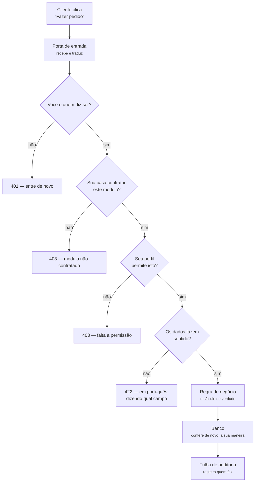
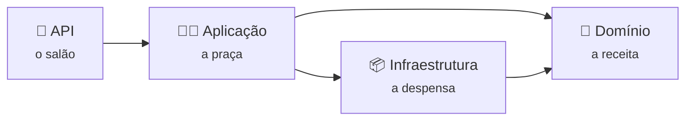
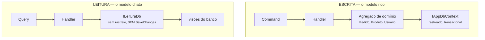
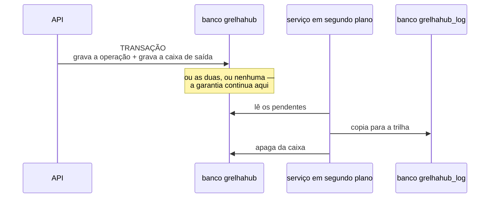
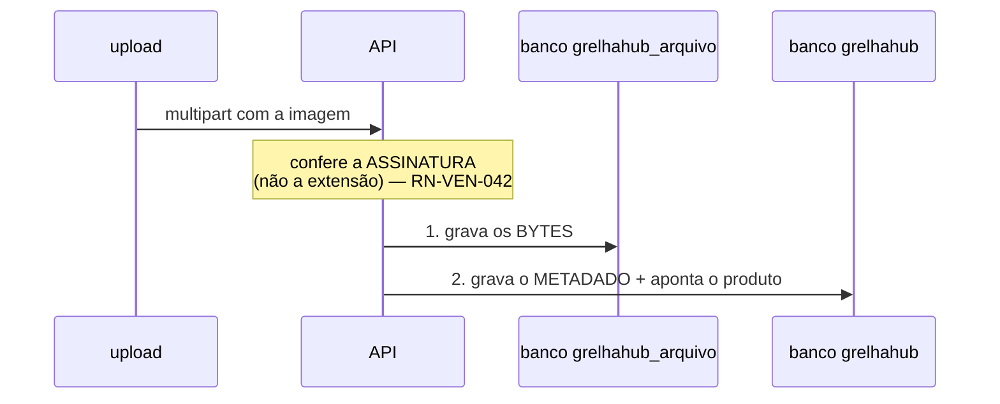

# 02 — Backend: o que acontece entre o clique e o banco

> **Para o time:** a Parte 1 explica sem jargão o caminho de um pedido. A Parte 2 mostra as pastas
> e os nomes reais, para quem vai mexer no código.

---

## Parte 1 — Para entender sem ser técnico

### O caminho de um pedido, do clique ao banco



**As quatro perguntas antes da regra** acontecem sempre, na mesma ordem, para toda operação. Não é
o programador que lembra de escrevê-las: elas estão no caminho, e uma operação nova passa por elas
sem que ninguém precise fazer nada.

### Por que existem quatro camadas

Imagine uma cozinha. O **salão** recebe o pedido e fala com o cliente. A **praça** decide o que
fazer com ele. A **despensa** guarda os ingredientes. E existe a **receita**, que não muda por
causa de quem está no salão nem de onde vieram os ingredientes.



| Camada | O que faz | O que ela **não** conhece |
|--------|-----------|---------------------------|
| **API** | Recebe a requisição HTTP e devolve a resposta | Não sabe calcular nada |
| **Aplicação** | Orquestra: valida, chama a regra, grava | Não sabe o que é HTTP |
| **Domínio** | As regras de negócio e os conceitos | **Não conhece banco nem framework de mensagens** |
| **Infraestrutura** | Banco, e-mail, arquivos | Não decide regra |

> ⚠ **O domínio tem exatamente UMA dependência externa, e ela é declarada** (ADR-0022 §1):
> `Microsoft.Extensions.Identity.Stores`, o pacote de POCOs do Identity de que `Usuario` e
> `Perfil` herdam. Ele não traz EF Core, não traz o runtime do ASP.NET, não traz MediatR — e a
> regra original continua valendo para o que ela existia: o domínio não depende de infraestrutura
> de persistência nem de mensageria. É o que permite testar a regra do dia operacional sem subir
> nada, e o que impede uma troca de tecnologia de arrastar a regra junto.

### As duas travas que sempre aparecem

**Módulo** e **permissão** respondem perguntas diferentes, e as duas precisam passar:

- *Módulo* — **a casa comprou isso?** Se o restaurante não contratou Estoque, a tela de estoque não
  existe para ele.
- *Permissão* — **esta pessoa pode?** Dentro de uma casa que tem Vendas, o atendente vê o pedido e
  não vê o faturamento.

### E duas garantias sobre a senha, desde 19/08/2026

**Errar a senha cinco vezes trava a conta por quinze minutos.** A mensagem diz que travou e quanto
tempo falta — travar em silêncio puniria o operador legítimo no meio do serviço, com a senha certa
e uma tela dizendo só "credenciais inválidas". O bloqueio expira sozinho: nunca vira uma fila de
desbloqueio para alguém atender.

**Trocar a senha derruba as sessões antigas.** Todo acesso emitido antes da troca morre na
requisição seguinte. Sem isso, quem teve a senha vazada trocava a senha e o invasor continuava
dentro por até oito horas — sessão que não morre com a senha não é sessão, é chave copiada.

### Onde cada regra é imposta — a decisão que define o projeto

O sistema valida em **duas camadas de propósito**:

> O banco garante que o dado nunca fica inválido.
> A aplicação garante que o usuário nunca chega até lá.

A ordem de preferência é: **modelagem → restrição do banco → coluna calculada → gatilho → visão →
aplicação**. A aplicação é o **último** recurso — o que a disciplina avalia é o modelo.

**Mas a mensagem de erro vem sempre da aplicação.** Erro de restrição do banco que chega ao usuário
é defeito: ninguém deve ler `ERROR: duplicate key value violates unique constraint`.

### Dinheiro e quantidade não são o mesmo tipo

Um número solto não distingue **R$ 12,00** de **12 gramas**, e o computador não impede somar os
dois. Pior: quantidade tratada com a precisão do dinheiro grava `0,1563` como `0,16` **sem erro
nenhum** — e o desvio entra no custo com um número plausível.

| Conceito | Precisão | Onde se usa |
|----------|----------|-------------|
| **Dinheiro** | 2 casas | Preço, total, taxa |
| **Quantidade** | 4 casas | Insumo, que se **mede** |
| **Contagem** | inteiro | Dois lanches, não 2,0000 lanches |

E há uma verificação que **recusa o sistema na partida** se alguém guardar dinheiro num tipo solto,
dizendo qual campo corrigir.

---

## Parte 2 — A estrutura real

### As pastas

```
backend/src/
├── GrelhaHub.Domain/          as regras e os conceitos — uma dependência declarada (ADR-0022)
│   ├── Common/                Dinheiro, Quantidade, CPF, CNPJ, Dia operacional
│   ├── Gerais/                Unidade, Usuário, Perfil, CatalogoDeAcesso, Módulo, Parâmetro
│   ├── Vendas/                Pedido, Item, Status
│   └── Cardapio/              Categoria, Produto
│
├── GrelhaHub.Application/     um caso de uso por pasta
│   ├── Common/                interfaces, exceções, os atributos de módulo e permissão
│   └── Features/<Módulo>/<Caso>/
│         Command ou Query  +  Handler  +  Validator
│
├── GrelhaHub.Infrastructure/  o mundo externo
│   ├── Persistence/           mapeamento, migrations, interceptadores
│   ├── Email/                 fila e envio
│   └── Arquivos/              imagens
│
└── GrelhaHub.Api/             controllers, autenticação, injeção de dependência
```

### Escrita e leitura são dois caminhos — ADR-0019

O sistema separa **quem mudou o quê** de **quem perguntou o quê**, e a separação é física, não uma
convenção:



| | Escrita | Leitura |
|---|---------|---------|
| Trabalha com | Agregados de domínio, com regras | Tipos **sem chave**, feitos para a tela |
| Contexto | `IAppDbContext` | `ILeituraDb` |
| Grava? | Sim | **A interface não tem o método** |
| Onde soma | Não soma: a regra decide | Na **visão do banco** |

**Três regras, e nenhuma delas depende de disciplina:**

1. Handler de consulta **não recebe** o contexto de escrita — a interface não é registrada para ele.
2. Handler de comando **não recebe** o de leitura: regra se decide sobre o agregado, nunca sobre uma
   projeção que pode não refletir o que a própria transação acabou de mudar.
3. Os modelos de leitura **não têm chave**, e o framework recusa gravar entidade sem chave.

> ⚠ **A separação é verificada por teste, não combinada em reunião.** `SeparacaoDeCqrsTests` varre
> os handlers por reflexão e recusa a build se alguma das regras acima for quebrada. Isto existe
> porque o projeto declarou "CQRS" num documento e entregou outra coisa por dois meses **sem
> ninguém notar** — a divergência não apareceu porque nada a media.
>
> **A conversão terminou: 16 de 16 consultas, 17 visões** — 17 consultas com a fila de
> monitoramento, que nasceu já do lado da leitura e **sem visão nova**: visão se justifica por
> agregação, e a fila filtra em vez de somar. Uma `vw_fila` seria a mesma soma escrita num segundo
> lugar, com o destino de toda segunda escrita.
>
> A conversão original: Ela foi feita por partes, e o que faltava
> ficava **nomeado** no próprio teste, numa lista que só andava para baixo — um teste recusava
> infrator fora dela, outro recusava nome nela que já tinha sido convertido. É o que impediu "por
> partes" de virar "pela metade, para sempre".
>
> ⚠ **A lista continua lá, vazia**, e isso é deliberado: é onde o próximo handler que precisar do
> agregado numa consulta terá de ser escrito à mão — e alguém vai perguntar por quê na revisão.

#### ⚠⚠ O que a conversão cobrou: regra que a leitura também precisa

Duas perguntas do cardápio público **não são projeção, são regra**: *"a casa está aberta agora?"*
(`RN-VEN-048`, com fuso da casa e turno que atravessa a meia-noite) e *"qual é o endereço em uma
linha?"* (`RN-GER-037`). As duas viviam dentro do agregado, e o handler convertido não carrega
agregado.

Traduzi-las para SQL, dentro da visão, teria criado **duas implementações da mesma regra** — que é o
defeito que o projeto persegue com testes de paridade. A saída foi **extrair a função pura**: o
agregado passa a chamá-la, e a leitura também.

> **Quando a leitura precisa de uma regra, extraia a função — não a traduza.** Tradução cria a
> segunda verdade que ninguém compara.

### Um caso de uso, por dentro

Cada operação é uma pasta com três arquivos que se leem em ordem:

| Arquivo | Responde |
|---------|----------|
| **Command / Query** | *o que se pede* — os dados de entrada, e os atributos que declaram módulo e permissão |
| **Validator** | *isto faz sentido?* — formato, obrigatoriedade, faixa |
| **Handler** | *o que acontece* — a regra, e só ela |

Exemplo real, o painel de operação:

```
Features/Vendas/ResumoDaOperacao/ResumoDaOperacao.cs
   [ExigeModulo(Vendas)] [ExigePermissao("operacao.visualizar")]
   ResumoDaOperacaoQuery(De, Ate, UnidadeId)
   ResumoDaOperacaoHandler  →  soma o faturamento, monta a série, calcula o ticket
```

### O que acontece sozinho, em toda operação

Três peças interceptam **toda** gravação, sem nenhum caso de uso precisar chamá-las:

| Peça | O que faz |
|------|-----------|
| **Filtro de unidade** | Acrescenta `unidade_id` em toda consulta. Um restaurante não vê o do outro |
| **Interceptador de unidade** | Preenche `unidade_id` no registro que nasce |
| **Interceptador de auditoria** | Escreve a trilha: quem, o quê, antes e depois |

> ⚠ **A ordem importa.** O de unidade roda **antes** do de auditoria: invertido, a trilha
> registraria a unidade vazia do registro que acabou de nascer.
>
> ⚠ **E o de auditoria exige diferença REAL de valor, não só a marca de "modificado".** O motivo é
> o Identity (ADR-0022): o `UserStore` grava por `Update(user)`, que marca a entidade **inteira**
> como alterada — sem a comparação, cada falha de login sujaria a trilha com nome, CPF e e-mail
> "alterados" que não mudaram. A comparação erra para o lado antigo: lista a mais, nunca a menos.

### A trilha atravessa dois bancos — ADR-0017

A trilha de auditoria mora num **banco separado**. Isso põe em risco a propriedade que a torna
confiável: *não existe operação sem registro* — que funcionava porque os dois gravavam na mesma
transação.

Bancos diferentes não compartilham transação. A saída é uma **caixa de saída**:



**Se a API cair no meio, nada se perde**: a linha continua na caixa e a próxima volta a encontra.

| Decisão | Por quê |
|---------|---------|
| Copiar **e depois** apagar | Invertido, uma falha entre as duas perderia a trilha — que é o que a ponte existe para impedir |
| Mesmo `id` dos dois lados | Torna a cópia **idempotente**: o serviço pode copiar e cair antes de apagar, e a segunda tentativa não duplica |
| Validar na **entrada** | Lixo recusado na caixa nunca chega ao banco de log, e não entope a fila bloqueando tudo atrás |
| Nunca descartar por tentativas | Trilha perdida é o que se quer evitar. O contador serve para o alerta: dez tentativas significa banco de log fora do ar, e isso precisa de gente |

> ⚠ **O preço, declarado:** a trilha chega ao banco de log com **segundos de atraso**. Quem consultar
> a auditoria de algo que acabou de acontecer pode não ver ainda.

### O que quebrou também vira dado

Toda exceção não tratada é gravada em `log_excecao`, com tipo, pilha, rota e o **identificador da
requisição** — o mesmo que o cliente recebe no corpo do erro. É por ele que o suporte encontra a
falha sem adivinhar horário.

> ⚠ O registro **nunca lança**. Ele roda dentro do tratador de exceções: uma falha ali substituiria a
> exceção original por outra, e o usuário receberia um erro sobre o registro do erro — perdendo
> justamente a causa que se queria guardar.

### A imagem é binário no banco — ADR-0018

A foto do produto e a logo da casa **não são arquivos em disco**. Elas são bytes na tabela
`arquivo_binario`, no banco `grelhahub_arquivo`, com um metadado do mesmo `id` no banco da
aplicação.



⚠⚠ **A ordem é a decisão.** Não há transação entre dois bancos, então uma das falhas vai acontecer
um dia — e escolhe-se qual: metadado sem bytes é **imagem quebrada que o cliente vê**; bytes sem
metadado é **invisível ao sistema e removível por varredura**. Quando não há transação, falhe do
lado que não mente para o usuário.

**A leitura tem duas rotas**, e a diferença entre elas importa:

| Rota | Devolve | Quem usa |
|------|---------|----------|
| `GET /api/v1/arquivos/{id}` | os **bytes**, com o tipo certo e cache de sete dias | `` da vitrine |
| `GET /api/v1/arquivos/{id}/base64` | o **data URI** | a miniatura do painel |

> ⚠ Base64 cresce o conteúdo em um terço e não entra no cache de imagem do navegador. Numa vitrine
> de vinte produtos aberta no celular do cliente, isso são megabytes antes do primeiro preço
> aparecer — por isso o padrão é a rota binária, e a base64 fica onde o conteúdo precisa viajar
> embutido.
>
> ⚠ As duas rotas são **anônimas**, como era o diretório que elas substituem: a foto do cardápio é
> vista por quem não tem login. O que mudou para melhor é que agora o **metadado é consultado antes
> dos bytes** — então excluir o registro tira a imagem do ar, coisa que apagar do Nginx não fazia.

### Como um erro vira mensagem

| Situação | Resposta | O que o usuário lê |
|----------|----------|--------------------|
| Dados inválidos | `422` | A mensagem do validador, em português |
| Regra de negócio recusou | `422` | A mensagem **e o número da regra** — é o que liga o erro ao catálogo |
| Sem permissão | `403` | Qual permissão falta |
| Módulo não contratado | `403` | Qual módulo |
| Conta bloqueada (`RN-GER-040`) | `401` | Que está bloqueada e **quanto tempo falta** — o restante, não a duração cheia: quem tenta de novo aos dez minutos lê "5 minutos", não um novo "15" |
| Sessão expirada — ou invalidada por troca de senha (`RN-GER-041`) | `401` | Volta para a tela de entrada |

> ⚠ **`401` só quando a sessão morreu.** Senha atual incorreta na troca de senha é `422`, não
> `401` — quem já está autenticado não tem falta de autenticação; o que falhou foi o valor
> digitado. Confundir os dois expulsava o usuário da tela antes de ele ler a mensagem.
>
> ⚠ O `401` do **login** (senha errada, conta bloqueada) é resposta da operação, não morte de
> sessão — e o frontend sabe disso: as rotas de credencial estão numa lista que impede o
> interceptor de transformar esse `401` em logout, e a mensagem chega inteira à tela.

### Identidade e acesso — ADR-0022

Desde 19/08/2026 o modelo de identidade é o **ASP.NET Core Identity**: `Usuario` herda de
`IdentityUser<Guid>`, `Perfil` de `IdentityRole<Guid>`, e o hash, a política de senha, o lockout e
o carimbo de segurança passam a ser mecanismo do framework — nas áreas em que o projeto **não**
tem opinião própria. Onde ele tem — perfil por unidade, delegação, usuário de plataforma, exclusão
lógica, token opaco — a regra continua nossa, e a ADR registra cada fronteira.

Entra por `AddIdentityCore`, e **não** `AddIdentity`: o pacote completo registraria autenticação
por cookie e redirecionamento para `/Account/Login` — aqui a autenticação é JWT (ADR-0003), e o
Identity é gestão de credencial e papel, nada mais.

#### A autorização é a do ASP.NET — e quem declara continua sendo o caso de uso

A permissão concedida virou **claim de papel** (`perfil_permissao`, tipo `permissao`, valor
`recurso.acao`), viaja no JWT emitido no login, e a verificação virou **política de autorização**:
na partida, a API registra **uma política por permissão do `CatalogoDeAcesso`**, com o mesmo nome
do código. Permissão nova no catálogo ganha política sozinha — não há segunda lista a manter.

> ⚠ **`[ExigePermissao]` permanece no request, e isso é deliberado** (ADR-0022 §3). A tentação era
> trocar tudo por `[Authorize(Policy = ...)]` no controller, e seria uma perda: o atributo no
> *request* é o que garante que nenhum caso de uso novo suba sem declarar o que exige — controller
> se esquece, request não, porque a partida recusa operação sem declaração. O `PermissaoBehavior`
> resolve a política pelo `IAuthorizationService`: o framework **executa** a decisão; quem a
> **declara** continua sendo o caso de uso.

#### O bloqueio por tentativa — `RN-GER-040`

Quem confere a senha é o `SignInManager`, com `lockoutOnFailure: true`: a falha incrementa
`falhas_de_acesso`, a quinta grava `bloqueado_ate` por quinze minutos, e o acerto zera o contador
— tudo do framework, nada nosso. As constantes vivem em `PoliticaDeBloqueio`, **nomeando** os
parâmetros que copiam (`PAR-GER-004`, `PAR-GER-005`): o escopo é global porque quem tenta entrar
ainda não tem unidade.

> ⚠ **A mensagem de bloqueio revela que a conta existe**, e isso abre uma fresta em `RN-GER-027`
> (login que responde igual para senha errada e conta inexistente). A fresta é **aceita e
> declarada**: enumerar contas passa a custar cinco tentativas por endereço, e o silêncio cobraria
> o preço da pessoa errada — o operador legítimo, no meio do serviço, sem saber por que a senha
> certa não entra.

#### A sessão morre com a senha — `RN-GER-041`, e o JWT deixou de ser puramente *stateless*

O `SecurityStamp` do usuário viaja no token (claim `carimbo`) e é conferido **a cada requisição
autenticada** contra o que está gravado. Trocar ou redefinir a senha regenera o carimbo — **no
domínio** (`TrocarSenha`/`RedefinirSenha`), não num `UserManager` que o handler poderia esquecer
de chamar —, e todo token emitido antes falha na comparação: `401` na requisição seguinte.

> ⚠ **O custo é assumido e registrado (emenda à ADR-0003):** uma consulta por requisição — uma
> coluna, pela chave primária —, e o JWT deixa de ser puramente *stateless*. A alternativa era o
> buraco que a ADR-0021 encontrou: senha vazada, senha trocada, e o atacante dentro por mais oito
> horas. Token **sem** carimbo também falha, fechado — aceitar seria manter viva exatamente a
> sessão que a regra existe para matar.

#### O que continua nosso, com o porquê

- **`MatrizDeDelegacao`** (`RN-GER-024`) — ninguém concede acesso que não possui; o sistema **não
  sobe** se um perfil novo não declarar o que delega. O Identity não tem equivalente.
- **`token_acesso`** (`RN-GER-032` a `035`) — convite e "esqueci minha senha" são token opaco, de
  uso único, guardado **só como hash**. O provedor do Identity não guarda token, e a regra decidiu
  guardar. E o endereço do link vem de **configuração**, nunca do cabeçalho da requisição — o furo
  clássico da troca de senha.
- **Usuário de plataforma** (`RN-GER-014`) — sem unidade, sem perfil, bypass próprio.
- **A exclusão física continua proibida** (`RN-GER-002`) — `UserManager.DeleteAsync` existe na API
  do framework e **nunca pode ser chamado**: um teste de arquitetura
  (`ExclusaoFisicaDeIdentityTests`) recusa a build se `.DeleteAsync(` aparecer em código de
  produção.
- Senha nunca é guardada — só o **hash**, irreversível, que já era do Identity antes da migração
  (`RNF-005`).

### Testes

| Tipo | Quantidade | O que provam |
|------|-----------:|--------------|
| Domínio | 110 | As regras isoladas: dia operacional, dinheiro, CPF |
| Aplicação | 19 | Fecho de dependência, modelo do e-mail, e a **separação de CQRS verificada** |
| Integração | 237 | **PostgreSQL de verdade** — os três bancos, num contêiner, com a API real |

**Nada de banco em memória.** O provider em memória não executa restrição, gatilho nem coluna
calculada — daria falsa confiança exatamente nas regras que mais importam.

O número da regra vai no nome do teste:

```csharp
[Fact(DisplayName = "RN-VEN-049 — faturamento conta só FINALIZADO; em andamento vai em contador separado")]
```

> Procurar por `RN-VEN-049` no repositório devolve a regra, o código e o teste. É o que torna a
> rastreabilidade real em vez de declarada.

### O teste que compara as duas camadas

Quando a mesma regra existe no banco **e** no código, o teste que importa é o de **paridade**: ele
compara o cálculo do dia operacional feito em C# com o da coluna calculada do banco, em 96 amostras
do dia. Duas implementações da mesma regra divergem em silêncio — este teste transforma a
divergência em falha.
