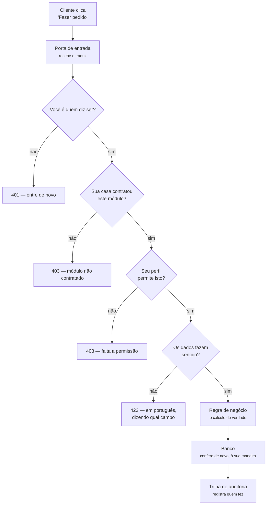
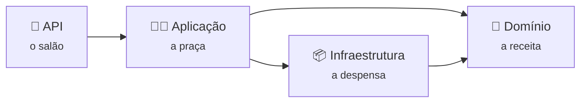
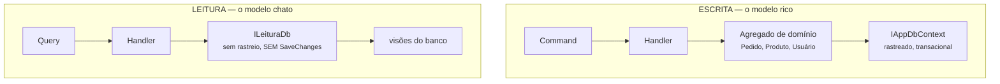
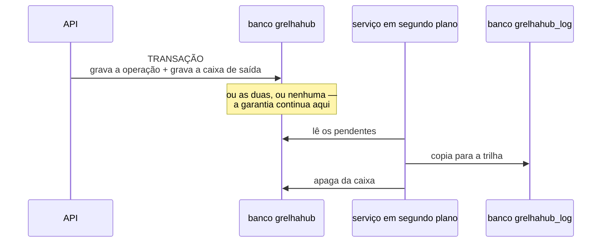

# 02 — Backend: o que acontece entre o clique e o banco

> **Para o time:** a Parte 1 explica sem jargão o caminho de um pedido. A Parte 2 mostra as pastas
> e os nomes reais, para quem vai mexer no código.

---

## Parte 1 — Para entender sem ser técnico

### O caminho de um pedido, do clique ao banco



**As quatro perguntas antes da regra** acontecem sempre, na mesma ordem, para toda operação. Não é
o programador que lembra de escrevê-las: elas estão no caminho, e uma operação nova passa por elas
sem que ninguém precise fazer nada.

### Por que existem quatro camadas

Imagine uma cozinha. O **salão** recebe o pedido e fala com o cliente. A **praça** decide o que
fazer com ele. A **despensa** guarda os ingredientes. E existe a **receita**, que não muda por
causa de quem está no salão nem de onde vieram os ingredientes.



| Camada | O que faz | O que ela **não** conhece |
|--------|-----------|---------------------------|
| **API** | Recebe a requisição HTTP e devolve a resposta | Não sabe calcular nada |
| **Aplicação** | Orquestra: valida, chama a regra, grava | Não sabe o que é HTTP |
| **Domínio** | As regras de negócio e os conceitos | **Não conhece banco nem framework nenhum** |
| **Infraestrutura** | Banco, e-mail, arquivos | Não decide regra |

> ⚠ **O domínio não tem nenhuma dependência externa** — nem do banco, nem do framework de
> mensagens. Isso não é purismo: é o que permite testar a regra do dia operacional sem subir nada,
> e o que impede uma troca de tecnologia de arrastar a regra junto.

### As duas travas que sempre aparecem

**Módulo** e **permissão** respondem perguntas diferentes, e as duas precisam passar:

- *Módulo* — **a casa comprou isso?** Se o restaurante não contratou Estoque, a tela de estoque não
  existe para ele.
- *Permissão* — **esta pessoa pode?** Dentro de uma casa que tem Vendas, o atendente vê o pedido e
  não vê o faturamento.

### Onde cada regra é imposta — a decisão que define o projeto

O sistema valida em **duas camadas de propósito**:

> O banco garante que o dado nunca fica inválido.
> A aplicação garante que o usuário nunca chega até lá.

A ordem de preferência é: **modelagem → restrição do banco → coluna calculada → gatilho → visão →
aplicação**. A aplicação é o **último** recurso — o que a disciplina avalia é o modelo.

**Mas a mensagem de erro vem sempre da aplicação.** Erro de restrição do banco que chega ao usuário
é defeito: ninguém deve ler `ERROR: duplicate key value violates unique constraint`.

### Dinheiro e quantidade não são o mesmo tipo

Um número solto não distingue **R$ 12,00** de **12 gramas**, e o computador não impede somar os
dois. Pior: quantidade tratada com a precisão do dinheiro grava `0,1563` como `0,16` **sem erro
nenhum** — e o desvio entra no custo com um número plausível.

| Conceito | Precisão | Onde se usa |
|----------|----------|-------------|
| **Dinheiro** | 2 casas | Preço, total, taxa |
| **Quantidade** | 4 casas | Insumo, que se **mede** |
| **Contagem** | inteiro | Dois lanches, não 2,0000 lanches |

E há uma verificação que **recusa o sistema na partida** se alguém guardar dinheiro num tipo solto,
dizendo qual campo corrigir.

---

## Parte 2 — A estrutura real

### As pastas

```
backend/src/
├── GrelhaHub.Domain/          as regras e os conceitos — sem dependências
│   ├── Common/                Dinheiro, Quantidade, CPF, CNPJ, Dia operacional
│   ├── Gerais/                Unidade, Usuário, Perfil, Permissão, Módulo, Parâmetro
│   ├── Vendas/                Pedido, Item, Status
│   └── Cardapio/              Categoria, Produto
│
├── GrelhaHub.Application/     um caso de uso por pasta
│   ├── Common/                interfaces, exceções, os atributos de módulo e permissão
│   └── Features/<Módulo>/<Caso>/
│         Command ou Query  +  Handler  +  Validator
│
├── GrelhaHub.Infrastructure/  o mundo externo
│   ├── Persistence/           mapeamento, migrations, interceptadores
│   ├── Email/                 fila e envio
│   └── Arquivos/              imagens
│
└── GrelhaHub.Api/             controllers, autenticação, injeção de dependência
```

### Escrita e leitura são dois caminhos — ADR-0019

O sistema separa **quem mudou o quê** de **quem perguntou o quê**, e a separação é física, não uma
convenção:



| | Escrita | Leitura |
|---|---------|---------|
| Trabalha com | Agregados de domínio, com regras | Tipos **sem chave**, feitos para a tela |
| Contexto | `IAppDbContext` | `ILeituraDb` |
| Grava? | Sim | **A interface não tem o método** |
| Onde soma | Não soma: a regra decide | Na **visão do banco** |

**Três regras, e nenhuma delas depende de disciplina:**

1. Handler de consulta **não recebe** o contexto de escrita — a interface não é registrada para ele.
2. Handler de comando **não recebe** o de leitura: regra se decide sobre o agregado, nunca sobre uma
   projeção que pode não refletir o que a própria transação acabou de mudar.
3. Os modelos de leitura **não têm chave**, e o framework recusa gravar entidade sem chave.

> ⚠ **A separação é verificada por teste, não combinada em reunião.** `SeparacaoDeCqrsTests` varre
> os 49 handlers por reflexão e recusa a build se alguma das regras acima for quebrada. Isto existe
> porque o projeto declarou "CQRS" num documento e entregou outra coisa por dois meses **sem
> ninguém notar** — a divergência não apareceu porque nada a media.
>
> A conversão das consultas é grande e foi feita por partes. O que falta está **nomeado** no teste,
> numa lista que só anda para baixo: um teste recusa infrator fora dela, outro recusa nome nela que
> já foi convertido. É o que impede "por partes" de virar "pela metade, para sempre".

### Um caso de uso, por dentro

Cada operação é uma pasta com três arquivos que se leem em ordem:

| Arquivo | Responde |
|---------|----------|
| **Command / Query** | *o que se pede* — os dados de entrada, e os atributos que declaram módulo e permissão |
| **Validator** | *isto faz sentido?* — formato, obrigatoriedade, faixa |
| **Handler** | *o que acontece* — a regra, e só ela |

Exemplo real, o painel de operação:

```
Features/Vendas/ResumoDaOperacao/ResumoDaOperacao.cs
   [ExigeModulo(Vendas)] [ExigePermissao("operacao.visualizar")]
   ResumoDaOperacaoQuery(De, Ate, UnidadeId)
   ResumoDaOperacaoHandler  →  soma o faturamento, monta a série, calcula o ticket
```

### O que acontece sozinho, em toda operação

Três peças interceptam **toda** gravação, sem nenhum caso de uso precisar chamá-las:

| Peça | O que faz |
|------|-----------|
| **Filtro de unidade** | Acrescenta `unidade_id` em toda consulta. Um restaurante não vê o do outro |
| **Interceptador de unidade** | Preenche `unidade_id` no registro que nasce |
| **Interceptador de auditoria** | Escreve a trilha: quem, o quê, antes e depois |

> ⚠ **A ordem importa.** O de unidade roda **antes** do de auditoria: invertido, a trilha
> registraria a unidade vazia do registro que acabou de nascer.

### A trilha atravessa dois bancos — ADR-0017

A trilha de auditoria mora num **banco separado**. Isso põe em risco a propriedade que a torna
confiável: *não existe operação sem registro* — que funcionava porque os dois gravavam na mesma
transação.

Bancos diferentes não compartilham transação. A saída é uma **caixa de saída**:



**Se a API cair no meio, nada se perde**: a linha continua na caixa e a próxima volta a encontra.

| Decisão | Por quê |
|---------|---------|
| Copiar **e depois** apagar | Invertido, uma falha entre as duas perderia a trilha — que é o que a ponte existe para impedir |
| Mesmo `id` dos dois lados | Torna a cópia **idempotente**: o serviço pode copiar e cair antes de apagar, e a segunda tentativa não duplica |
| Validar na **entrada** | Lixo recusado na caixa nunca chega ao banco de log, e não entope a fila bloqueando tudo atrás |
| Nunca descartar por tentativas | Trilha perdida é o que se quer evitar. O contador serve para o alerta: dez tentativas significa banco de log fora do ar, e isso precisa de gente |

> ⚠ **O preço, declarado:** a trilha chega ao banco de log com **segundos de atraso**. Quem consultar
> a auditoria de algo que acabou de acontecer pode não ver ainda.

### O que quebrou também vira dado

Toda exceção não tratada é gravada em `log_excecao`, com tipo, pilha, rota e o **identificador da
requisição** — o mesmo que o cliente recebe no corpo do erro. É por ele que o suporte encontra a
falha sem adivinhar horário.

> ⚠ O registro **nunca lança**. Ele roda dentro do tratador de exceções: uma falha ali substituiria a
> exceção original por outra, e o usuário receberia um erro sobre o registro do erro — perdendo
> justamente a causa que se queria guardar.

### Como um erro vira mensagem

| Situação | Resposta | O que o usuário lê |
|----------|----------|--------------------|
| Dados inválidos | `422` | A mensagem do validador, em português |
| Regra de negócio recusou | `422` | A mensagem **e o número da regra** — é o que liga o erro ao catálogo |
| Sem permissão | `403` | Qual permissão falta |
| Módulo não contratado | `403` | Qual módulo |
| Sessão expirada | `401` | Volta para a tela de entrada |

> ⚠ **`401` só quando a sessão morreu.** Senha atual incorreta na troca de senha é `422`, não
> `401` — quem já está autenticado não tem falta de autenticação; o que falhou foi o valor
> digitado. Confundir os dois expulsava o usuário da tela antes de ele ler a mensagem.

### Segurança, em quatro linhas

- Senha nunca é guardada — só o **hash**, irreversível.
- Link de acesso (convite, "esqueci minha senha") é **de uso único**, com validade curta, guardado
  **só como hash**.
- Ninguém concede acesso que não possui: uma **matriz de delegação** recusa, e o sistema **não
  sobe** se um perfil novo não declarar o que delega.
- O endereço do link do e-mail vem de **configuração**, nunca do cabeçalho da requisição — é o furo
  clássico da troca de senha.

### Testes

| Tipo | Quantidade | O que provam |
|------|-----------:|--------------|
| Domínio | 92 | As regras isoladas: dia operacional, dinheiro, CPF |
| Aplicação | 18 | Fecho de dependência, modelo do e-mail, e a **separação de CQRS verificada** |
| Integração | 209 | **PostgreSQL de verdade** — dois bancos, num contêiner, com a API real |

**Nada de banco em memória.** O provider em memória não executa restrição, gatilho nem coluna
calculada — daria falsa confiança exatamente nas regras que mais importam.

O número da regra vai no nome do teste:

```csharp
[Fact(DisplayName = "RN-VEN-049 — faturamento conta só FINALIZADO; em andamento vai em contador separado")]
```

> Procurar por `RN-VEN-049` no repositório devolve a regra, o código e o teste. É o que torna a
> rastreabilidade real em vez de declarada.

### O teste que compara as duas camadas

Quando a mesma regra existe no banco **e** no código, o teste que importa é o de **paridade**: ele
compara o cálculo do dia operacional feito em C# com o da coluna calculada do banco, em 96 amostras
do dia. Duas implementações da mesma regra divergem em silêncio — este teste transforma a
divergência em falha.
