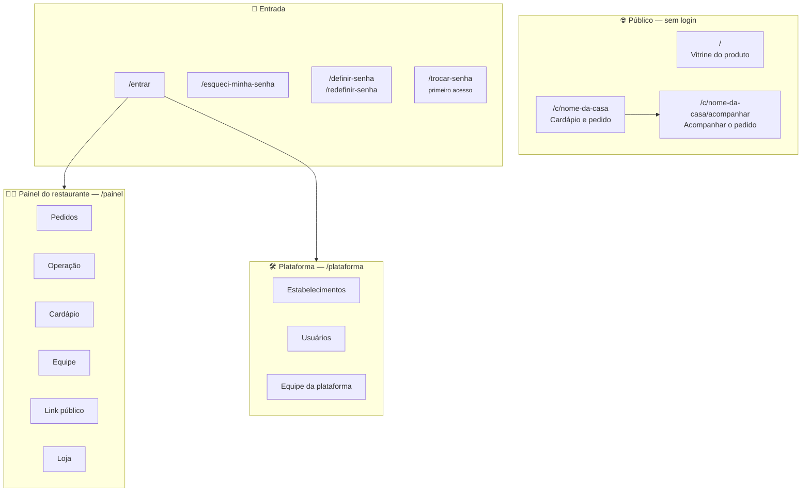

# 03 — Frontend: as telas e quem enxerga cada uma

> **Para o time:** a Parte 1 é o mapa das telas e a identidade visual. A Parte 2 é a estrutura de
> pastas, para quem vai mexer.

---

## Parte 1 — Para entender sem ser técnico

### O mapa das telas



### Quem vê cada aba do painel

A aba que a pessoa não pode abrir **não aparece**. Esconder é conveniência — o servidor recusa de
qualquer forma —, mas aba que abre em "você não pode" é pior do que aba ausente.

| Aba | Quem vê | Permissão |
|-----|---------|-----------|
| **Pedidos** | Todos que operam | `pedido.visualizar` |
| **Operação** ⭐ | Administrador e Gerente | `operacao.visualizar` |
| **Cardápio** | Quem gere o cardápio | `cardapio.visualizar` |
| **Equipe** | Quem administra pessoas | `usuario.visualizar` |
| **Link público** | Todos que operam | — |
| **Loja** | Quem vê endereço e horário | `unidade.visualizar` |

> ⚠ **Por que "Operação" tem permissão própria e não usa a de pedido?** Quem atende o telefone
> precisa ver o pedido da mesa 4; o faturamento da semana é outra pergunta e responde a quem
> responde pelo resultado. Agregado de venda é o passo anterior a margem — conceder junto abriria
> por uma porta lateral o que a regra de custo fecha na porta da frente.

### A identidade visual, em uma página

A direção se chama **Chapa**. Ela é intencionalmente **cartoon por fora, sem graça por dentro**:
personalidade na moldura, e nada atrapalhando o dado.

| Elemento | Regra |
|----------|-------|
| **Sombra** | Sólida e deslocada, 5px em carvão. **Nunca borrada** — sombra que desfoca faz o cartão flutuar; a Chapa quer peso |
| **Traço** | 2px em carvão, em toda borda |
| **A listra âmbar** | Em qualquer grupo, **exatamente uma barra é âmbar**: a ativa. Aba, etapa do pedido, dia selecionado, melhor dia do gráfico |
| **Tipografia** | Dado em **mono** com números alinhados; frase em **sans**. Peso só no número do pedido e no total |
| **Cor** | Do kit de marca, e não se altera. Laranja é **ação**, verde é **sucesso** — misturar apaga os dois |
| **Toque** | 48px na operação — o painel roda em tablet, com a mão ocupada |

### O que **não** entra, e por quê

Está escrito para poder ser recusado em revisão com referência, e não com "não gostei":

| Anti-padrão | Por quê |
|-------------|---------|
| Gradiente decorativo | Não tem relação com brasa. É a assinatura do visual genérico |
| Vidro fosco / desfoque de fundo | Sem materialidade; some sobre fundo claro |
| Sombra cinza borrada | O cartão flutua em vez de pesar |
| **Emoji como ícone ou estado** | Renderiza diferente em cada sistema, sem contraste garantido. Estado é **selo com borda e cor** |
| Fonte baixada da internet | O painel não pode depender de fonte chegando no meio do serviço |
| Biblioteca de gráfico | Traz junto todo o repertório acima. Barra é retângulo, e retângulo a gente desenha |

### Duas armadilhas que já custaram defeito

**Frase não usa cor secundária.** O cinza claro é para rótulo e metadado — `Total`, `12:04:31`. Um
parágrafo inteiro em cinza é bonito em captura de tela e ruim às 22h no tablet da cozinha. E texto
**nunca** leva transparência: o contraste resultante não aparece em nenhuma ferramenta de
verificação, porque ela mede a cor declarada.

**Quem declara fundo declara cor de texto.** Um cartão que define o fundo e não define a cor herda
a cor de quem o contém. Foi assim que a comanda da vitrine ficou creme sobre creme — e o
diagnóstico demorou porque as partes que tinham cor própria continuaram legíveis.

---

## Parte 2 — A estrutura real

### As pastas

```
frontend/src/
├── app/
│   ├── App.tsx               as rotas
│   └── estilos-globais.css   os tokens e todo o visual do produto
│
├── components/               peças reusadas, do design system
│   ├── Grelha.tsx            a listra âmbar
│   ├── Comanda.tsx           o cartão do pedido
│   ├── Selo.tsx              o estado, com borda e cor
│   ├── Dialogo.tsx           confirmação — nunca `confirm()` do navegador
│   ├── CampoDeData.tsx       data sem o widget do navegador
│   ├── CampoDeHora.tsx       hora sem o widget do navegador
│   ├── EnvioDeImagem.tsx     logo e foto de produto
│   └── Icone.tsx             SVG inline
│
├── features/
│   ├── site/                 a vitrine pública
│   ├── publico/              cardápio e acompanhamento — sem login
│   ├── admin/                o painel do restaurante
│   └── plataforma/           a administração do produto
│
└── services/
    ├── api.ts                cliente HTTP, sessão e tradução de erro
    ├── periodo.ts            o recorte de dia operacional
    ├── ciclo.ts              as etapas do pedido
    ├── dinheiro.ts / cpf.ts / datas.ts
    └── tipos.ts
```

### Por que campos de data e hora são nossos

O `<input type="date">` do navegador traz o calendário, o formato e a tipografia **do sistema
operacional** — três coisas que não são nossas, dentro de uma interface que recusa exatamente isso.
Numa lista de sete dias o efeito é pior que num campo isolado: as sete linhas parecem um formulário
de outro produto.

### O filtro de período, e a armadilha que ele revelou

O painel de pedidos e o painel de operação usam o mesmo filtro de **dia operacional**.

> ⚠⚠ **O número do pedido reinicia a cada dia operacional.** Quando o filtro passou a trazer mais
> de um dia, a comanda `#1` de hoje e a `#1` de ontem apareceram lado a lado, idênticas, sem nada
> dizendo que eram pedidos diferentes. Por isso a lista é **agrupada por dia**, com uma faixa
> nomeando o bloco: "Hoje · 2026-08-18 · 4 pedidos". O agrupamento não é organização visual — é o
> que impede uma leitura errada.

### O painel de operação

| Bloco | O que mostra |
|-------|--------------|
| **Indicadores** | Faturamento, ticket médio, o que está no salão, cancelados |
| **Gráfico por dia** | Uma barra por dia operacional; a mais alta é âmbar |
| **Mais vendidos** | Ranking por quantidade, com o total |

> ⚠ **O que está no salão fica fora do faturamento**, e o rótulo diz isso onde o número aparece.
> Contar o que ainda pode ser cancelado dá um número que **encolhe sozinho** depois — e número que
> anda para trás sem ninguém mexer destrói a confiança no painel inteiro.

E **dia sem pedido aparece com zero**, não some: série com dia faltando faz o olho ler continuidade
onde houve fechamento.

### A tradução de erro

Toda mensagem que o usuário lê **vem do servidor** — o frontend não reescreve regra de negócio em
texto próprio. Quando o servidor recusa citando uma regra, o número dela aparece na tela, e é o que
permite ao suporte responder sem adivinhar.

### Os gates

| Comando | O que garante |
|---------|---------------|
| `npm ci` | ⚠ **Obrigatório antes.** Sem as dependências, os comandos abaixo imprimem erro e **saem com sucesso** — o gate parece verde e não rodou nada |
| `tsc -b` | Tipos |
| `eslint .` | Padrão de código |
| `vite build` | Que compila de verdade |

> ⚠ **Confira o código de saída do `eslint` e do `tsc`, não o do `npm run`.** É a diferença entre
> um gate que verifica e um que só parece verificar.
