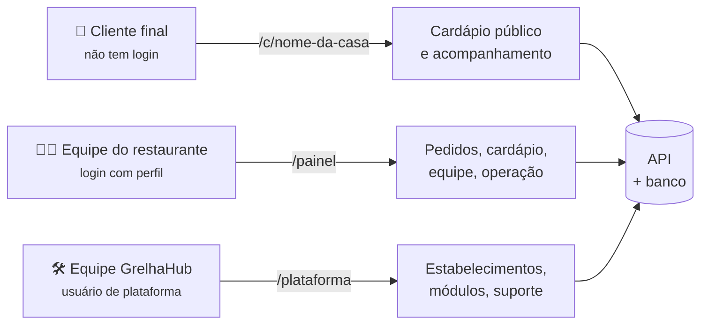
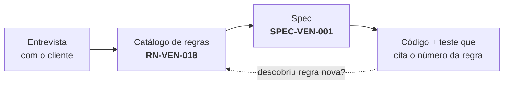

# Arquitetura do GrelhaHub — como o sistema é feito

> **Para quem é este documento:** o time inteiro. Quem programa, quem apresenta, quem só precisa
> entender do que se fala numa reunião. Cada capítulo começa em português comum e **só depois**
> desce ao detalhe técnico — dá para parar na metade e ainda ter entendido a peça.

| Documento | O que responde |
|-----------|----------------|
| **[01 — Modelo de dados](01-modelo-de-dados.md)** | Onde cada informação mora, como as tabelas se ligam, e o dicionário completo: chave primária, chave estrangeira, tipo de dado |
| **[02 — Backend](02-backend.md)** | O que acontece entre o clique e o banco. As quatro camadas, e por que existem |
| **[03 — Frontend](03-frontend.md)** | As telas, quem enxerga o quê, e como a identidade visual chega até elas |

---

## O sistema em um parágrafo

O **GrelhaHub** é um ERP para restaurantes e deliveries. Um restaurante — que aqui se chama
**unidade** — cadastra o cardápio, ganha um endereço público (`grelhahub.com/c/nome-da-casa`) onde
o cliente faz pedido sem instalar aplicativo, e acompanha esse pedido no painel até a entrega. Por
cima disso existe a **plataforma**: nós, que operamos o produto, cadastramos os clientes e damos
suporte.

## As três audiências, e as três portas

O cliente final **nunca faz login**. Quem opera o restaurante entra com e-mail e senha e tem um
**perfil** que decide o que ele vê. Quem opera o produto é um **usuário de plataforma** — que não
pertence a restaurante nenhum e enxerga todos.

## O vocabulário que evita confusão

Estes cinco termos aparecem o tempo todo. Errar um deles trava uma conversa inteira.

| Termo | O que significa aqui |
|-------|----------------------|
| **Unidade** | Um restaurante, uma loja, um ponto. **Nunca dizemos "estabelecimento"** no código nem no banco |
| **Dia operacional** | O "dia" do restaurante, que não é o do calendário. Se a casa fecha às 3h da manhã, o pedido da 1h30 de domingo é **faturamento de sábado** |
| **Módulo** | Um pedaço vendável do sistema — Vendas, Estoque, Financeiro. O cliente contrata o que quer |
| **Perfil** | Um cargo com um conjunto de permissões: Administrador, Gerente, Atendente, Cozinha |
| **Permissão** | Uma capacidade específica, no formato `recurso.ação` — `pedido.cancelar`, `custo.visualizar` |

> ### ⚠ O dia operacional é a ideia mais importante do sistema inteiro
>
> Um restaurante que fecha às 3h da manhã de domingo vendeu **na noite de sábado**. Se o sistema
> agrupasse pelo relógio, esse faturamento cairia em domingo, o fechamento de caixa não bateria, e
> o relatório de "melhor dia da semana" ficaria errado para sempre — sem ninguém perceber, porque o
> número continua parecendo plausível.
>
> Por isso cada pedido guarda **em que dia operacional ele nasceu**, calculado pelo próprio banco no
> momento em que a linha é gravada. Detalhe em [01 — Modelo de dados](01-modelo-de-dados.md#a-coluna-que-o-banco-calcula-sozinho).

## Onde este projeto guarda as decisões

O GrelhaHub é conduzido em **Document First**: nenhuma regra de negócio nasce no código. Antes de
existir uma tela, existe uma regra escrita e numerada.

Cada regra tem um número (`RN-VEN-018`), um estado — **hipótese** ou **decidida** — e aparece no
nome do teste que a garante. Procurar por `RN-VEN-018` no repositório devolve a regra, a spec e o
teste. É isso que torna o projeto defensável: **nenhuma decisão é só "a gente achou melhor assim"**.

| Onde | O que tem |
|------|-----------|
| [`docs/03-catalogo-de-regras-de-negocio.md`](../03-catalogo-de-regras-de-negocio.md) | As 180 regras, com estado e mecanismo |
| [`docs/adr/`](../adr/) | As decisões de arquitetura, com o que foi descartado e por quê |
| [`docs/08-design-system.md`](../08-design-system.md) | A identidade visual e as onze regras de tela |

## A tecnologia, em uma tabela

| Camada | O que usamos | Por quê, em uma frase |
|--------|--------------|------------------------|
| Banco | **PostgreSQL**, em **três bancos** | Colunas calculadas, restrições e tipos de data e hora que o resto não tem — e três bancos porque o que mora em cada um cresce e é guardado por motivos diferentes |
| Backend | **.NET 10** + ASP.NET Core | Tipagem forte no lugar onde o dinheiro é calculado |
| Frontend | **React + TypeScript** | O painel roda em tablet de cozinha; nada de instalar aplicativo |
| Entrega | **Docker + Nginx**, uma VPS | Um comando sobe o sistema inteiro |

### Os três bancos, e por que não é um só — ADR-0017

| Banco | O que guarda | Cresce com | Quanto tempo fica |
|-------|--------------|-----------|-------------------|
| `grelhahub` | O negócio: pedido, produto, usuário | O uso do sistema | Para sempre |
| `grelhahub_log` | A trilha de auditoria e as exceções | **Cada gravação** e cada falha | Política própria |
| `grelhahub_arquivo` | Os binários das imagens *(planejado — ADR-0018)* | Fotos de produto | Segue o metadado |

O motivo é prático: a trilha era a tabela que mais crescia, e com tudo junto o *backup* do banco de
negócio carregava três anos de histórico toda vez. Separados, cada um tem o seu ritmo.

> ### ⚠ A trilha atravessa dois bancos sem perder a garantia
>
> A regra é: **não existe operação sem registro**. Isso funcionava porque os dois gravavam na mesma
> transação — ou as duas coisas, ou nenhuma.
>
> Bancos diferentes não compartilham transação. A solução é uma **caixa de saída**: a operação grava
> o registro numa fila dentro da própria transação, e um serviço em segundo plano o leva para o
> banco de log segundos depois. Se o sistema cair no meio, o registro continua na fila e a próxima
> volta o encontra.
>
> **O que se paga:** a trilha chega com **segundos de atraso**. Quem consultar a auditoria de algo
> que acabou de acontecer pode não ver ainda. Está declarado no ADR-0017.

---

## Como este documento é mantido

Os números de tabelas, colunas e tipos deste capítulo **foram extraídos do modelo real** do
sistema, não escritos de memória. Quando o banco mudar, este documento fica desatualizado e
precisa ser regerado — e é por isso que ele diz sempre a data da última extração.

**Última extração: 18/08/2026 (segunda).** **Três bancos**: 18 tabelas na aplicação com 13
relacionamentos, 2 tabelas no banco de log, e 5 visões de leitura.

> ⚠ A primeira extração deste documento dizia "19 tabelas". A diferença não é erro de contagem: no
> mesmo dia a arquitetura mudou três vezes — a trilha saiu para banco próprio (ADR-0017), a sessão
> de suporte foi removida (ADR-0020) e a leitura ganhou visões (ADR-0019). É por isso que este
> documento diz a DATA da extração em vez de fingir ser atemporal.
